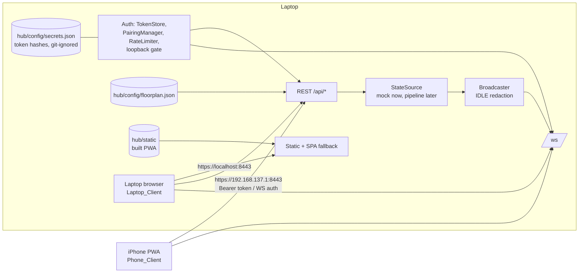
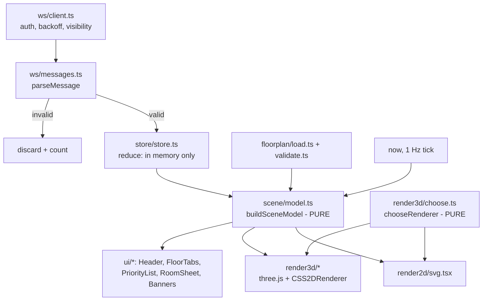
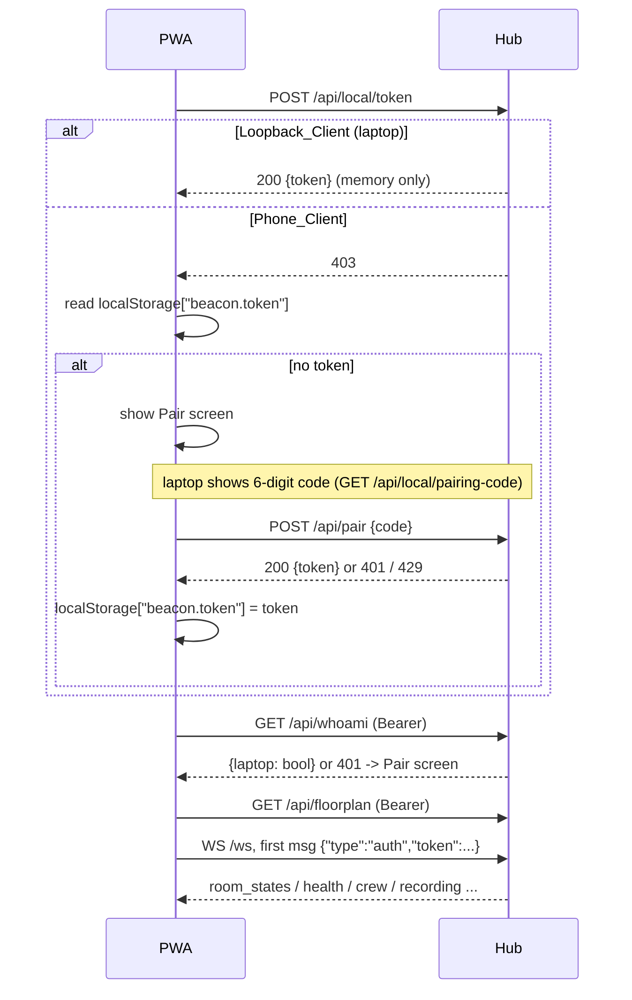

# Design Document: PWA Dashboard

## Overview

This design delivers three pieces that run together on the hub laptop and an iPhone on the laptop's hotspot:

1. **`dashboard/`**: a Vite + TypeScript + Preact PWA. A typed WebSocket client feeds an in-memory Store. A pure `buildSceneModel()` turns the floor plan plus the Store into per-room descriptors. Two renderers (SVG 2D, three.js 3D) draw those descriptors and make no decisions. Preact UI chrome adds the header, floor tabs, priority list, room sheet, banners, pairing screen, and laptop-only controls.
2. **`hub/`**: a small FastAPI web layer. It serves the built PWA, the floor plan, pairing and token auth, laptop-only endpoints, mark-searched, and a WebSocket broadcast of the parent's message shapes. It gets its data from a pluggable `StateSource`.
3. **`tools/mock_hub.py`**: runs the web layer with a scripted incident `StateSource` (`simulated: true`), so the dashboard can be built and filmed before the sensing pipeline exists.

The parent spec (`.kiro/specs/beacon-occupancy-tool/`) stays the source of truth for state, confidence, ranking, recording, and tag logic. The PWA only formats what the hub sends. Requirement references are to this spec's `requirements.md` unless written "parent R…".

Code examples use TypeScript for the dashboard and Python for the hub, matching the two runtimes this feature adds.

### Design principles

- **One pure view model, two renderers.** All safety-relevant display logic (labels, stale handling, hub-lost, rank badges, crew rules, IDLE redaction) lives in `scene/model.ts` and is property-tested. Renderers draw descriptors only.
- **Server is the truth.** The client never computes Room_State, Confidence, or ranking. It filters the server `ranking` to Flagged_Rooms and formats ages.
- **Deny by default on the network.** Every `/api/*` route and `/ws` needs a token. Laptop-only actions also need a loopback client address. The hub listens only on configured addresses.
- **Nothing about occupants touches the phone's disk.** The service worker precaches the shell only, and occupancy lives only in JS memory.

## Architecture



### Client data flow



The UI re-runs `buildSceneModel` on every Store change and on a 1 Hz tick (so ages and the 5 s hub-lost rule advance without messages).

### Startup and pairing sequence



### Repository layout

```
dashboard/
  index.html  vite.config.ts  tsconfig.json  package.json  playwright.config.ts
  public/  icons/ (team-drawn SVG + PNG), fonts/ (Atkinson Hyperlegible .woff2 + OFL.txt)
  src/
    main.tsx  app.tsx
    api/http.ts                 # fetch wrapper: Bearer, 401 -> pair, 403 -> phone
    auth/session.ts             # startup flow above; token storage (only localStorage key)
    floorplan/types.ts load.ts validate.ts
    ws/messages.ts client.ts backoff.ts
    store/store.ts              # in-memory reducer, lastMessageAt, IDLE purge
    scene/model.ts palette.ts patterns.ts format.ts strings.ts geometry.ts
    render2d/svg.tsx
    render3d/choose.ts scene.ts walls.ts floors.ts nodes.ts links.ts crew.ts camera.ts labels.ts
    ui/Header.tsx HealthChip.tsx FloorTabs.tsx PriorityList.tsx RoomSheet.tsx Banners.tsx
       Pair.tsx LaptopControls.tsx SnapshotInset.tsx FireEntry.tsx wakelock.ts
  tests/  *.test.ts (Vitest + fast-check)  privacy/*.test.ts  e2e/*.spec.ts (Playwright)
hub/
  __init__.py  requirements.txt  .env.example
  web/ __init__.py app.py auth.py settings.py listeners.py source.py broadcast.py messages.py
  config/floorplan.json         # committed
  config/secrets.json           # git-ignored, created at runtime
  certs/                        # git-ignored mkcert output
  static/                       # committed Vite build output
  tests/ test_auth.py test_routes.py test_laptop_gate.py test_broadcast.py test_listeners.py
tools/
  mock_hub.py  mock_incident.py  tests/test_mock_incident.py
.kiro/steering/ui.md  .kiro/hooks/*.json
```

## Components and Interfaces

### Dashboard: messages (`ws/messages.ts`) — Req 7.1, 7.2

Types mirror the parent design's "Hub: Web Server" shapes exactly. `parseMessage` validates field names, types, and enum values and returns `null` on any mismatch; it never throws.

```typescript
export type RoomStateValue = "MOTION" | "POSSIBLE" | "UNKNOWN" | "NO_DETECTION";
export type StateLabel = "MOTION" | "POSSIBLE" | "UNKNOWN" | "NO DETECTION";
export type Band = "high" | "medium" | "low";
export type SystemState = "IDLE" | "CALIBRATION" | "TEST" | "ALARM_ACTIVE";
export type LinkHealth = "ok" | "degraded" | "offline";
export type Annotation = "responder_present" | "recent_motion_may_be_responder" | null;

export interface RoomEntry {
  room_id: string; state: RoomStateValue; label: StateLabel;
  confidence_band: Band; confidence_pct: number;          // 0..100
  last_seen: number | null; last_evidence: number | null; // epoch seconds
  stale: boolean; last_known_state: RoomStateValue | null; stale_age_s: number | null;
  calibrated: boolean; searched: boolean; annotation: Annotation;
  alarm_time_state: RoomStateValue | null; link_health: LinkHealth;
  source: "edge" | "hub"; model_ver: number | null;
}
export interface RoomStatesMsg {
  type: "room_states"; ts: number; system_state: SystemState; simulated: boolean;
  rooms: RoomEntry[]; ranking: string[];
}
export interface HealthNode {
  node_id: string; role: "TX" | "RX"; room_id: string;
  status: "ok" | "degraded" | "offline" | "tx_dead";
  measured_pps?: number; inferred_from?: string; cause?: string; action?: string;
}
export interface HealthMsg {
  type: "health"; ts: number; summary: string; nodes: HealthNode[];
  tag_faults: { tag_id: string; last_room: string; silent_s: number }[];
}
export interface CrewTag {
  tag_id: string; location_kind: "room" | "near" | "between" | "lost";
  room_id: string | null; near_rooms: string[]; confidence_band: Band;
  last_heard_s: number; marker: "solid" | "hollow"; you_are_here: boolean;
}
export interface CrewMsg { type: "crew"; ts: number; tags: CrewTag[]; floor_crew_counts: Record<string, number>; }
export interface RecordingMsg {
  type: "recording"; ts: number; indicator: string; stored_samples: number; fault: string | null;
}
export type HubMessage = RoomStatesMsg | HealthMsg | CrewMsg | RecordingMsg;

export function parseMessage(raw: string): HubMessage | null;   // null = discard (Req 7.2)
```

The `label` field must equal the label for `state` (`NO_DETECTION` ↔ `"NO DETECTION"`); a mismatch is a parse failure. The client never sends `trigger_alarm` or `end_incident` over the WebSocket; the laptop uses REST.

### Dashboard: WS client (`ws/client.ts`, `ws/backoff.ts`) — Req 7.3–7.6

```typescript
export function backoffMs(attempt: number): number; // min(500 * 2^attempt, 5000), attempt >= 0
export interface WsClient { start(): void; stop(): void; status(): "connecting" | "open" | "reconnecting"; }
export function createWsClient(url: string, token: () => string | null,
  onMessage: (m: HubMessage, receivedAt: number) => void, onAuthFail: () => void): WsClient;
```

- On `open`: send `{"type":"auth","token":...}` first.
- On close code 4401: call `onAuthFail` (drop the stored token, show Pair screen) instead of retrying.
- On other close: retry after `backoffMs(attempt++)`; reset `attempt` on the first message.
- On `visibilitychange` → visible, or `online`: close and reconnect immediately; UI shows "Reconnecting…" until the first message.

### Dashboard: Store (`store/store.ts`) — Req 7.6, 14.4, 17.3

```typescript
export interface StoreState {
  roomStates: RoomStatesMsg | null; health: HealthMsg | null;
  crew: CrewMsg | null; recording: RecordingMsg | null;
  lastMessageAt: number | null;            // ms, receipt time
  lastKnown: Record<string, StateLabel>;   // last label per room, for hub-lost text
  discarded: number;
}
export function reduce(s: StoreState, m: HubMessage, receivedAt: number): StoreState;
```

- `reduce` is pure. When a `room_states` message has `system_state: "IDLE"`, it sets `roomStates` to that message with `rooms: []` and `ranking: []` (defence in depth), and clears `crew.tags` and `lastKnown` (Req 14.2, 14.4).
- The Store is a module-level variable plus a subscriber list. It has no persistence adapter, and no code path writes it to any Web Storage, IndexedDB, or Cache API (Req 17.3).

### Dashboard: floor plan (`floorplan/*`) — Req 6

```typescript
export interface Door { wall: number; offset: number; width: number; swing: "in" | "out"; }
export interface Furniture { kind: string; rect: [x: number, y: number, w: number, d: number]; }
export interface RoomPlan {
  id: string; name: string; polygon: [number, number][]; doors: Door[];
  furniture: Furniture[]; crewSlot: [number, number]; simulated?: boolean;
}
export interface FloorPlanFloor { id: string; name: string; rooms: RoomPlan[]; }
export interface NodePlan { id: string; role: "TX" | "RX"; room: string; pos: [number, number]; h: number; }
export interface FloorPlan { floors: FloorPlanFloor[]; nodes: NodePlan[]; links: { tx: string; rx: string }[]; }

export type FloorplanError = { rule: "polygon" | "door" | "node_room" | "link" | "duplicate_id" | "schema"; id: string; message: string };
export function validateFloorplan(input: unknown): { ok: true; plan: FloorPlan } | { ok: false; errors: FloorplanError[] };
```

- `door.wall` is the polygon edge index `i` (from vertex `i` to vertex `(i+1) % n`). This replaces the plan's compass letter so non-rectangular rooms work. A door is valid when `offset >= 0` and `offset + width <= edge length + 0.001`.
- A polygon is valid with at least 3 vertices and shoelace area `> 0.01 m²` (the closing edge is implicit).
- Messages are plain language, for example `Room "R2": door 1 runs past the end of wall 0 (offset 3.2 m + width 0.9 m > wall 3.96 m).`
- `simulated` defaults to `false`. The plan's `live` field is replaced by `simulated` (the inverse), because D4 and parent R10.5 are phrased in terms of simulated rooms.

**Committed `hub/config/floorplan.json`** (Req 6.5, 6.6): F1 has R1 "Conference" `[[0,0],[3.96,0],[3.96,2.84],[0,2.84]]` with a 0.91 m door on wall 3 (the west 2.84 m wall) at offset 0.0, a table block, and nodes TX1/RX1 about 0.61 m (2 ft) from the entry wall; and R2 "Storage" sharing R1's east wall. F2 has R3 "Office", R4 "Classroom", R5 "Break room", each `simulated: true`. Furniture and door swing are TODO in CONTEXT.md and use placeholders until measured.

### Dashboard: Scene_Model (`scene/model.ts`) — Req 8, 9, 11, 12, 13.5, 14.2, 15, 16.5

```typescript
export interface CrewItem {
  tagId: string; kind: "marker" | "chip"; hollow: boolean;
  roomId: string | null;       // only for kind "marker"
  text: string;                // "E1", "E1 · Near R1 / R2", "E1 · Between rooms", "Last heard R2, 0:40 ago"
  colors: ["#FFFFFF", "#111111"];
}
export interface RoomDescriptor {
  roomId: string; floorId: string | null; name: string;
  polygon: [number, number][] | null; centroid: [number, number] | null;
  treatment: RoomStateValue | "NONE";   // "NONE" only in IDLE
  label: StateLabel | null; icon: IconId | null; pattern: PatternId | null;
  fill: string | null; saturation: 1 | 0.75 | 0.5; opacity: 1 | 0.35; greyed: boolean;
  rank: number | null; halo: boolean;
  confidenceText: string | null;        // "HIGH 86%"
  subText: string[];                    // "Motion last seen 0:42 ago", "Still needs a sweep", stale text, "No data from hub"
  chips: ("SEARCHED" | "SIMULATED" | "Uncalibrated" | "Not on floor plan")[];
  annotations: string[];                // label text only
  crew: CrewItem[]; simulated: boolean; searched: boolean;
  ariaLabel: string;                    // "<name>, <label>, rank <n>"
  effectAnchor: [number, number] | null; // always the centroid
}
export interface SceneModel {
  mode: "idle" | "fire"; rooms: RoomDescriptor[];       // floor-plan rooms then off-plan rooms
  priority: string[];                                    // room ids, server order, flagged only
  snapshot: { roomId: string; treatment: RoomStateValue | null }[];
  floorTabs: { floorId: string; name: string; attention: number; crew: number }[];
  banners: { hubLost: boolean; allSearched: boolean; reconnecting: boolean };
  header: { recording: string | null; health: string | null; simulatedData: boolean; alarm: boolean };
}
export function buildSceneModel(plan: FloorPlan, s: StoreState, nowMs: number, link: "connecting" | "open" | "reconnecting"): SceneModel;
```

Rules, in evaluation order per room:

| Step | Condition | Result |
|---|---|---|
| 1 | `system_state` is IDLE (or no `room_states` yet) | `treatment: "NONE"`, no label/rank/pattern/fill (Req 14.2) |
| 2 | Hub lost: `nowMs - lastMessageAt >= 5000` | `greyed: true`; subText "STALE — last known <lastKnown[room]>, <age since lastMessageAt> ago"; `banners.hubLost` (Req 12.2, 12.3) |
| 3 | Room on plan but not in message (fire mode) | UNKNOWN treatment, subText "No data from hub" (Req 8.4) |
| 4 | `stale` true | UNKNOWN treatment, subText "last known <label(last_known_state)>, <age(stale_age_s)> ago" (Req 12.1) |
| 5 | `calibrated` false | UNKNOWN treatment plus "Uncalibrated" chip (Req 9.8) |
| 6 | Otherwise | treatment = `state`; NO_DETECTION adds "Still needs a sweep"; non-stale adds "Motion last seen <age(now - last_seen)> ago" (Req 9.5, 12.5) |

Steps 3–5 change only the drawn treatment. The `label` shown is the treatment's label, so a stale or uncalibrated room reads UNKNOWN even if `state` disagrees. Step 2 composes on top of 3–6 (greyed plus stale text). Off-plan rooms (in the message, not on the plan) get `polygon: null` and the "Not on floor plan" chip (Req 8.5).

- `priority = ranking.filter(id => flagged(treatmentOf(id)))`, where `flagged = MOTION | POSSIBLE | UNKNOWN`. `rank` is the 1-based index in `priority`; `halo` is true only for `priority[0]` when that room is not searched (Req 8.2, 8.3, 11.8). Rooms not in `ranking` get no rank.
- `opacity` is 0.35 when `searched` (Req 11.3). `saturation` is 1, 0.75, or 0.5 for high, medium, or low (Req 9.7). `pattern`, `icon`, `label`, and `fill` depend only on `treatment` (Req 9.2, 15.7).
- `floorTabs[f].attention` = number of unsearched rooms on floor `f` whose treatment is flagged. `crew` = `floor_crew_counts[f] ?? 0` (Req 11.5, 15.6).
- `banners.allSearched` = `priority.length > 0 && priority.every(searched)` (Req 11.6).
- `snapshot` = each room's `alarm_time_state` from the message; not affected by crew, annotations, stale, or searched (Req 13.5, parent R27.4).
- `effectAnchor` is the polygon centroid for every room (Req 16.5).

Crew rules (Req 15):

| `crew` tag | Result |
|---|---|
| `marker: "hollow"` | marker, `hollow: true`, at `room_id` (last-heard room), text "Last heard <room>, <age> ago" |
| `location_kind: "room"` and band `high` or `medium` | marker, solid, at `room_id`, text = tag id |
| `location_kind: "near"` | chip "<tag> · Near <a> / <b>", `roomId: null` |
| `location_kind: "between"`, or band `low` with kind `room` | chip "<tag> · Between rooms" or "<tag> · Near <room>…" from `near_rooms`; `roomId: null` |
| `location_kind: "lost"` | chip "<tag> · not heard", `roomId: null` |

Crew colors are always `["#FFFFFF", "#111111"]` (Req 15.1). Low confidence never yields a marker inside a room (Req 15.5).

### Dashboard: format and strings (`scene/format.ts`, `scene/strings.ts`) — Req 9.6, 12.5

```typescript
export function formatAge(seconds: number): string;      // 0 -> "0:00", 42 -> "0:42", 3725 -> "1:02:05"; floors fractions, clamps < 0 to 0
export function parseAge(text: string): number;          // inverse, for tests
export const STRINGS: Record<string, string>;            // every user-visible literal lives here
export const BANNED = /\b(empty|clear(ed)?|safe)\b/i;
```

All UI copy comes from `STRINGS` so one test can scan it. The disclaimer is `STRINGS.disclaimer = "Decision support only — does not replace a full search"`.

### Dashboard: palette and patterns (`scene/palette.ts`, `scene/patterns.ts`) — Req 9.2–9.4

| Treatment | Fill | Rel. luminance | Pattern | Icon | Label | Animation (off under reduced motion) |
|---|---|---|---|---|---|---|
| MOTION | `#FF4D2E` | ≈ 0.268 | solid | wave | MOTION | rings from centroid every 1.2 s, clipped to polygon |
| POSSIBLE | `#FFB020` | ≈ 0.524 | 45° hatch | outline-with-? | POSSIBLE | 3 s edge glow |
| UNKNOWN | `#6E6596` | ≈ 0.144 | cross-hatch + fine noise | ? | UNKNOWN | none |
| NO DETECTION | `#3A4250` (outline emphasis) | ≈ 0.054 | sparse dots | dash | NO DETECTION | none |

Pairwise contrast ratios `(L1 + 0.05) / (L2 + 0.05)`: POSSIBLE/MOTION ≈ 1.80, MOTION/UNKNOWN ≈ 1.64, UNKNOWN/NO DETECTION ≈ 1.87, all others larger, so every pair is ≥ 1.4 (Req 9.3). No hue lies in 75–165° (Req 9.4).

**Deviation from the plan.** Plan section 4.2 lists UNKNOWN as `#8A7FB8` and asks for the luminance order MOTION > POSSIBLE > UNKNOWN > NO DETECTION. With the plan's colors, amber POSSIBLE (≈ 0.52) is brighter than red-orange MOTION (≈ 0.27), and `#8A7FB8` (≈ 0.24) is nearly the same grey as MOTION (ratio ≈ 1.10). A red-orange cannot be made brighter than amber without turning yellow. So this design darkens UNKNOWN to `#6E6596`, requires pairwise contrast ≥ 1.4 with NO DETECTION darkest instead of a strict order, and relies on the pattern channel plus MOTION's animation and the rank halo for salience.

Patterns are procedural (SVG `<pattern>` in 2D, `CanvasTexture` in 3D) tiled in world units (hatch spacing 0.25 m). The simulated overlay is repeating "SIMULATED" text at 30° and 25% opacity.

Text colors: `#FFFFFF` on `#0E1116` background and on label plates (`#0E1116E6`), and `#111111` on POSSIBLE badges, each ≥ 4.5:1 (Req 19.3).

### Dashboard: renderers — Req 16, 22

**Renderer_2D (`render2d/svg.tsx`)**: top-down SVG in a `viewBox` of the floor's bounds in meters. Walls are 0.12 m stroked polygon edges with door gaps cut out; each door has a leaf line and a quarter-circle swing arc. Furniture is low-contrast grey rectangles. Nodes are rounded squares with a status dot (green ok, amber degraded, dark with "!" offline; health colors, not state colors). Links are dashed lines; `tx_dead` gives a red broken dash plus a fault icon; an offline RX hides the link and shows "!" at the RX (Req 16.6). Labels are HTML overlays positioned at centroids. The 2D renderer also draws the Snapshot_Inset.

**Renderer_3D (`render3d/*`)**, cut order item 4:
- `OrthographicCamera` at about 35° tilt and 45° yaw; two-finger rotate snaps to 90° steps; pinch zoom clamped to 0.5–3×; double-tap a room to frame it.
- Walls: one merged `BufferGeometry` per floor, extruded 1.0 m, door openings cut, matte off-white with a darker top cap. Contact shadows are a baked gradient strip at each wall base. Lighting is one `HemisphereLight` plus one `DirectionalLight` with a 1024² shadow map.
- Floors: one mesh per room with the pattern `CanvasTexture`; fill color and saturation from the descriptor.
- Nodes at real mounting height `h`; link beams as thin tubes with dashes moving at a speed proportional to `measured_pps`.
- Labels: `CSS2DRenderer` HTML elements at room centroids (state label, confidence, rank badge, chips), so they stay tappable and readable by screen readers (Req 16.3).
- Other floors are drawn as stacked ghost slabs.
- Budget: pixel ratio `min(devicePixelRatio, 2)`; render on demand (message arrival, active animation, gesture); stop on `document.hidden`; under 50 draw calls (Req 22.2, 22.3).

**Renderer choice (`render3d/choose.ts`)**, pure (Req 16.4):

```typescript
export function chooseRenderer(input: {
  include3d: boolean; webglAvailable: boolean; contextLost: boolean;
  frameTimesMs: number[];            // samples from the last 3 s
  userPrefers2d: boolean;
}): "3d" | "2d";
// "2d" if !include3d || !webglAvailable || contextLost || userPrefers2d
//      || (frameTimesMs.length >= 30 && median(frameTimesMs) > 33)
```

The WebGL context is created with `failIfMajorPerformanceCaveat: true`; failure counts as `webglAvailable: false`. Switching to 2D shows "2D view" in the header.

### Dashboard: UI chrome — Req 1, 5, 10, 11, 13, 19

- **Header**: Recording_Indicator (from `recording.indicator`), Health_Chip (tap → fault list with `cause` and `action` from `health.nodes[]` and `tag_faults[]`), disclaimer (2 lines max), "SIMULATED DATA" badge, "SIMULATED TRIGGER" label (laptop, after trigger). The disclaimer is also rendered on the Pair and floor-plan-error screens (Req 10.1).
- **FloorTabs**: one 56 px button per floor with "•<attention>" and a crew count. One tap switches floors (Req 11.5).
- **PriorityList**: portrait bottom sheet (first 3 rows visible, drag up for the rest); landscape or ≥ 900 px wide side list (Req 1.2, 1.3). Each row: rank disc, name, label, confidence text, age or stale text, and a 56 px ✓ button. Tapping ✓ swaps the row into a confirm state with a "Mark searched" button; the second tap calls `POST /api/rooms/{id}/searched` (2 taps, Req 11.2). The list re-renders from the next server `room_states`; there is no optimistic reorder.
- **RoomSheet**: state, confidence, "Motion last seen", `alarm_time_state`, `link_health`, an "Edge"/"Hub" source badge (+ `model_ver`), crew present, and the mark-searched control (Req 11.4).
- **Banners**: Hub_Lost_Banner (full width, top), "Reconnecting…", All_Searched_Banner.
- **Pair**: 6 large digit buttons in a keypad (no OS keyboard needed); it is shown only in normal mode or before any session. Fire mode never shows it unless the token is rejected.
- **LaptopControls** (shown only when `whoami.laptop`): alarm-trigger button (IDLE landing view), End incident (fire mode) with confirm sheet, "Pair a phone" (polls `GET /api/local/pairing-code` and shows code plus seconds left), "Revoke phones" with confirm (Req 5.3–5.6).
- **FireEntry**: on the IDLE → ALARM_ACTIVE transition in the Store: red header and `theme-color` within one frame; 1 s full-screen red flash unless `matchMedia("(prefers-reduced-motion: reduce)")`; camera frames all Flagged_Rooms over 600 ms; Priority_List opens to 3 rows (Req 13.1–13.3).
- **wakelock.ts**: `navigator.wakeLock?.request("screen")` in try/catch; re-request on `visibilitychange` → visible; silently no-op if unsupported (Req 13.4).
- **SnapshotInset**: a 2D mini-plan from `scene.snapshot`, labeled "AT ALARM", tap to swap with the live view. If cut to a toggle (cut item 3), it shows behind an "At alarm" button (Req 13.5, 13.6).
- **Fire-mode no typing**: no `<input>` or `<textarea>` is mounted while `mode === "fire"` (Req 11.7).

### Dashboard: PWA config (`vite.config.ts`) — Req 17, 18

```typescript
VitePWA({
  registerType: "autoUpdate",
  manifest: { name: "Beacon", short_name: "Beacon", display: "standalone", orientation: "any",
    background_color: "#0E1116", theme_color: "#0E1116", icons: [/* 192, 512, maskable 512 */] },
  workbox: {
    globPatterns: ["**/*.{html,js,css,woff2,svg,png,webmanifest}"],
    navigateFallback: "/index.html",
    navigateFallbackDenylist: [/^\/api\//, /^\/ws/],
    runtimeCaching: [],                       // none (Req 17.1)
  },
})
```

`index.html` links `apple-touch-icon` and sets `<meta name="theme-color">`. Fonts are `@font-face` from `/fonts/*.woff2` with `font-display: swap` and a system fallback stack. If the woff2 files are not in the repo, the stack falls back to `system-ui, -apple-system, "Segoe UI", sans-serif` and `public/fonts/TODO.md` names the missing files (Req 18.2). No URL to any external origin appears in the build (Req 18.1).

### Hub: settings (`hub/web/settings.py`) — Req 4

Loaded from `hub/.env` (git-ignored) with defaults; `hub/.env.example` is committed.

| Key | Default | Meaning |
|---|---|---|
| `HUB_BIND_HOSTS` | `127.0.0.1,192.168.137.1` | Listener addresses |
| `HUB_PORT` | `8443` | Port for every listener |
| `HUB_CERT_FILE` / `HUB_KEY_FILE` | `hub/certs/hub.pem` / `hub/certs/hub-key.pem` | mkcert output |
| `HUB_SECRETS_FILE` | `hub/config/secrets.json` | Token hashes |
| `HUB_FLOORPLAN_FILE` | `hub/config/floorplan.json` | Floor plan |
| `HUB_STATIC_DIR` | `hub/static` | Built PWA |

### Hub: listeners (`hub/web/listeners.py`) — Req 4.1–4.4

```python
@dataclass(frozen=True)
class Listener:
    host: str
    port: int
    tls: bool

def plan_listeners(settings: Settings, cert_ok: bool, local_addrs: set[str]) -> tuple[list[Listener], list[str]]:
    """Pure. Returns listeners and plain-language log lines.
    cert_ok False -> [Listener("127.0.0.1", port, tls=False)] plus a message naming the missing file.
    Hosts not in local_addrs are skipped with a message naming them."""

async def serve(app, listeners: list[Listener], settings: Settings) -> None:
    """Run one uvicorn.Server per listener in one event loop (asyncio.gather)."""
```

`0.0.0.0` is never used, so the hub is not exposed on the venue network.

### Hub: auth (`hub/web/auth.py`) — Req 2, 3, 5.1

```python
class Clock(Protocol):
    def __call__(self) -> float: ...       # monotonic seconds, injected for tests

def is_loopback(host: str | None) -> bool: ...   # ipaddress.ip_address(host).is_loopback; None/invalid -> False

class TokenStore:
    def __init__(self, path: Path): ...    # loads {"phone_token_sha256": [...]} if present
    def issue_phone(self) -> str: ...      # secrets.token_urlsafe(32); persist sha256 hex
    def issue_local(self) -> str: ...      # memory only
    def valid(self, token: str | None) -> Literal["phone", "local", None]: ...  # hmac.compare_digest on hashes
    def revoke_phones(self) -> None: ...   # clears phone hashes, persists
    # writes are atomic: temp file + os.replace

class PairingManager:
    def __init__(self, clock: Clock, ttl_s: float = 120.0): ...
    def new_code(self) -> tuple[str, float]: ...    # f"{secrets.randbelow(10**6):06d}", expires_in_s; replaces any prior code
    def redeem(self, code: str) -> bool: ...        # True once for the current unexpired code

class RateLimiter:
    def __init__(self, clock: Clock, limit: int = 5, window_s: float = 60.0): ...
    def allow(self, client: str) -> bool: ...       # sliding window per client address
```

FastAPI dependencies:

```python
def require_token(request: Request) -> str: ...             # 401 on missing/invalid Bearer
def require_laptop(request: Request) -> None: ...           # 403 unless is_loopback(request.client.host)
```

For Laptop_Only_Endpoints, `require_laptop` runs before `require_token`, so a non-loopback caller always gets 403 (Req 5.1, 3.1).

### Hub: routes (`hub/web/app.py`) — Req 2, 3, 5, 6.1, 20

`create_app(source: StateSource, settings: Settings, clock: Clock = time.monotonic) -> FastAPI`

| Method | Path | Guards | Behavior |
|---|---|---|---|
| `POST` | `/api/local/token` | laptop | `{token}` (memory only) |
| `POST` | `/api/pair` | rate limit | `{code}` → `{token}` / 401 / 429 |
| `GET` | `/api/local/pairing-code` | laptop, token | `{code, expires_in_s}` |
| `POST` | `/api/local/revoke-phones` | laptop, token | clears phone tokens; closes phone sockets |
| `GET` | `/api/whoami` | token | `{laptop: bool}` |
| `GET` | `/api/floorplan` | token | file contents read per request; 500 with a plain message if unreadable |
| `POST` | `/api/alarm/trigger` | laptop, token | `source.trigger_alarm()` → parent shape `{"system_state":"ALARM_ACTIVE","simulated":...}` |
| `POST` | `/api/incident/end` | laptop, token | `source.end_incident()` → `{"system_state":"IDLE"}` |
| `POST` | `/api/rooms/{room_id}/searched` | token | 404 if unknown; else `source.mark_searched()` and immediate broadcast |
| `WS` | `/ws` | auth first message (5 s) | close 4401 on failure; phone sockets ignore `trigger_alarm`/`end_incident` |
| `GET` | `/{path}` | none | static file from `hub/static` or `index.html` (SPA fallback); `/api/*` never falls back |

Responses set `Cache-Control: no-store` on every `/api/*` route.

### Hub: state source and broadcast (`hub/web/source.py`, `hub/web/broadcast.py`) — Req 7.7, 14.1, 20

```python
class StateSource(Protocol):
    def room_ids(self) -> set[str]: ...
    def snapshot(self, now: float) -> list[dict]: ...      # current room_states, health, crew, recording messages (parent shapes)
    def trigger_alarm(self, now: float) -> dict: ...
    def end_incident(self, now: float) -> dict: ...
    def mark_searched(self, room_id: str, now: float) -> None: ...

def redact_for_wire(msg: dict) -> dict:
    """Pure. room_states with system_state IDLE -> rooms [] and ranking []; crew in IDLE -> tags [] and counts {}."""

class Broadcaster:
    async def run(self, source: StateSource, clock: Clock, period_s: float = 1.0) -> None: ...
    # every period: snapshot -> redact_for_wire -> send to all authenticated sockets
    async def publish_now(self) -> None: ...   # after commands (searched, alarm, end)
```

The real pipeline later implements `StateSource` over the parent's State_Engine, ranking, and system state machine. The web layer writes nothing to disk except `secrets.json` (Req 20.6).

### Mock hub (`tools/mock_incident.py`, `tools/mock_hub.py`) — Req 21

`ScriptedIncident(plan_rooms: dict[str, str], clock)` implements `StateSource`. `plan_rooms` maps room id to floor id, read from the floor plan, so a floor plan without F2 yields an incident without F2 rooms. All `room_states` have `simulated: true`.

Timeline, `t` = seconds since alarm:

| t (s) | R1 | R2 | E1 | Health | F2 (if present) |
|---|---|---|---|---|---|
| IDLE | — | — | — | all ok, 1 Hz | — |
| 0–15 | MOTION high 86, `responder_present` while E1 in R1 | NO_DETECTION medium 62 | room R1 high (0–12) | ok | R3 POSSIBLE med, R4 NO_DETECTION high, R5 uncalibrated |
| 12–18 | | | near [R1, R2] low | | |
| 15–∞ | POSSIBLE medium 64; `recent_motion_may_be_responder` from t ≥ 18 | | | | |
| 18–30 | | MOTION high, `responder_present` | room R2 high | | |
| 30–45 | | POSSIBLE medium | silent; hollow from t ≥ 40, last R2 | tag fault E1 from t ≥ 40 | |
| 45–55 | | POSSIBLE low (RX2 degraded from 48) | | RX2 degraded | |
| 55–∞ | | UNKNOWN, `stale: true`, `last_known_state: "POSSIBLE"`, `stale_age_s = t − 45` | | RX2 offline; TX2 cause "inferred from RX2" | |

`alarm_time_state` is frozen at the `t = 0` values. Ranking uses a local pure `rank()` that mirrors parent R9: MOTION, POSSIBLE, UNKNOWN, NO_DETECTION; ties by more recent `last_seen`; searched rooms after all unsearched. End incident resets to IDLE and clears searched marks. `python tools/mock_hub.py` builds settings, calls `plan_listeners`, and serves.

## Data Models

| Model | Where | Lifetime |
|---|---|---|
| `HubMessage` types | `ws/messages.ts`, `hub/web/messages.py` (TypedDict) | wire only; client JS memory |
| `StoreState` | client | JS memory; room/crew entries dropped on IDLE |
| `FloorPlan` | `hub/config/floorplan.json`; client memory | file is installation config, not Occupancy_Data |
| `SceneModel` / `RoomDescriptor` | client | recomputed per render |
| Pairing_Token (plain) | phone `localStorage["beacon.token"]`; laptop JS memory | until revoked |
| Token hashes | `hub/config/secrets.json` `{"version":1,"phone_token_sha256":[...]}` | until revoked; git-ignored |
| Pairing_Code | hub memory | 120 s, single use |
| Rate-limit windows | hub memory | 60 s sliding |

## Security

- **Threat model.** Other devices on the WPA2 hotspot, and anyone on the venue Wi-Fi. Mitigations: listeners bound to loopback and the hotspot address only; TLS; bearer tokens on all data routes; loopback gate on destructive actions; rate-limited pairing; 6-digit code valid 120 s and shown only on the laptop.
- **Residual risks (state these in the README).** A paired phone that is lost keeps access until "Revoke phones" is used. The token in `localStorage` is readable by any script on the origin, which is acceptable because the origin serves only our bundled code. The mkcert root CA on the iPhone trusts any cert signed by that CA; keep `rootCA-key.pem` off the repo and remove the profile after the event. The loopback check trusts the socket peer address, so the hub must not run behind a reverse proxy.
- **Not in scope.** Installer PIN, calibration, and test-mode endpoints remain as specified in the parent and are not exposed by this web layer.
- **Secrets.** `hub/.env`, `hub/certs/`, `*.pem`, and `hub/config/secrets.json` are git-ignored; `.kiro/` is never ignored.

## Error Handling

| Situation | Behavior |
|---|---|
| WS message fails `parseMessage` | Discard, increment `discarded`, Store unchanged (Req 7.2) |
| WS closes | Backoff 0.5 s → 5 s; "Reconnecting…"; hub-lost after 5 s without messages (Req 7.4, 12.2) |
| WS close 4401 / HTTP 401 | Phone: remove stored token, show Pair screen. Laptop: fetch a new local token |
| HTTP 403 on a laptop action | Hide laptop controls (should not happen; the UI hides them) |
| HTTP 429 on pairing | "Too many tries. Wait a minute, then enter the new code from the laptop." |
| Floor plan invalid | Error screen with plain-language list and the disclaimer; no plan drawn (Req 6.4) |
| Floor plan unreadable on hub | 500 with `{"error": "Floor plan file could not be read: <path>"}`; app shows it |
| WebGL missing / lost / slow | Switch to 2D, "2D view" chip (Req 16.4) |
| Wake Lock unsupported or rejected | Ignore; README tells the team to set Auto-Lock to Never on older iOS (Req 13.4) |
| Cert missing | HTTP on 127.0.0.1 only, log names the missing file (Req 4.3) |
| Bind address missing | Log the address, keep other listeners (Req 4.4) |
| `secrets.json` corrupt | Log, start with no phone tokens (phones re-pair), do not crash |
| Unknown room in mark-searched | 404 `{"error":"Unknown room"}` (Req 20.5) |

## Correctness Properties

*A property is a characteristic or behavior that should hold true across all valid executions of a system—essentially, a formal statement about what the system should do. Properties serve as the bridge between human-readable specifications and machine-verifiable correctness guarantees.*

Properties 1–19 are tested in the dashboard with Vitest + fast-check; properties 20–26 are tested in the hub with pytest + Hypothesis. Plan section 7 IDs are noted as (P-UI1) … (P-UI6).

### Property 1: Message parsing round-trips and rejects malformed input

*For any* valid `HubMessage` generated from the parent shapes, `parseMessage(JSON.stringify(m))` deep-equals `m`; and *for any* mutation that removes a required field, changes a type, or uses an out-of-set enum value (including a `label` that does not match `state`), `parseMessage` returns `null` without throwing and `reduce` leaves the Store unchanged except for `discarded + 1`.

**Validates: Requirements 7.1, 7.2**

### Property 2: Only the four labels, no banned words (P-UI1)

*For any* floor plan, Store contents, and time, every non-null `label` in the Scene_Model is one of MOTION, POSSIBLE, UNKNOWN, NO DETECTION; every NO DETECTION room has the sub-text "Still needs a sweep"; every `ariaLabel` contains the room name and its label; and no user-visible string in the Scene_Model or in `STRINGS` matches `/\b(empty|clear(ed)?|safe)\b/i`.

**Validates: Requirements 9.1, 9.5, 9.6, 19.2**

### Property 3: The Scene_Model passes server values through and is pure

*For any* floor plan and ALARM_ACTIVE `room_states` message whose rooms are a random subset of plan rooms plus random extra rooms, each descriptor's confidence text, `searched`, and `opacity` (0.35 iff searched) come from that room's entry; each plan room missing from the message has UNKNOWN treatment with "No data from hub"; each extra room appears with "Not on floor plan"; and two calls with the same inputs return deep-equal results without mutating the inputs.

**Validates: Requirements 8.1, 8.4, 8.5, 8.6, 11.3**

### Property 4: Priority list equals the server ranking filtered to flagged rooms (P-UI2)

*For any* ALARM_ACTIVE `room_states` message with an arbitrary `ranking` permutation, `scene.priority` equals `ranking` filtered to rooms whose treatment is MOTION, POSSIBLE, or UNKNOWN, in the same order; each listed room's `rank` is its 1-based index; unlisted rooms have no rank; and at most one room has `halo: true`, which is `priority[0]` when it is unsearched.

**Validates: Requirements 8.2, 8.3, 8.5, 11.8**

### Property 5: Encoding depends only on the treatment

*For any* room entry, varying its `confidence_band`, `confidence_pct`, `annotation`, and the `crew` tags located in it leaves the descriptor's `treatment`, `label`, `icon`, `pattern`, `fill`, and `rank` unchanged; `saturation` is 1, 0.75, or 0.5 exactly when the band is high, medium, or low; and annotation text appears only in `annotations`.

**Validates: Requirements 9.2, 9.7, 15.7**

### Property 6: Crew markers never use state colors or false precision (P-UI3)

*For any* `crew` message, every crew item's colors are exactly `#FFFFFF` and `#111111` and none is in the State_Palette; every tag with `location_kind` "near", "between", or "lost", or with low confidence and `marker: "solid"`, produces a chip with `roomId: null` and no marker; every `marker: "hollow"` tag produces a hollow marker whose text contains "Last heard" and its age.

**Validates: Requirements 15.1, 15.2, 15.3, 15.4, 15.5**

### Property 7: Stale and uncalibrated rooms get the UNKNOWN treatment (P-UI4)

*For any* room entry with `stale: true`, the descriptor has UNKNOWN treatment and a sub-text "last known <label of last_known_state>, <formatAge(stale_age_s)> ago"; *for any* entry with `calibrated: false`, the descriptor has UNKNOWN treatment and the "Uncalibrated" chip.

**Validates: Requirements 12.1, 9.8**

### Property 8: Hub-lost after exactly 5 seconds (P-UI5)

*For any* Store with `lastMessageAt = L` and any `now`, `banners.hubLost` is true iff `now − L ≥ 5000 ms`; when true every descriptor is `greyed` and each room with a last-known label shows "STALE — last known <label>"; when false no descriptor is greyed for hub loss.

**Validates: Requirements 12.2, 12.3, 12.4, 7.6**

### Property 9: The State_Palette is grayscale-distinguishable and never green (P-UI6)

*For all* pairs of distinct treatments, the WCAG relative-luminance contrast ratio of their fills is at least 1.4, their patterns differ, and their icons differ; NO DETECTION has the lowest luminance; no fill has an HSL hue in [75°, 165°]; and every text/background pair in the palette has contrast ≥ 4.5.

**Validates: Requirements 9.2, 9.3, 9.4, 19.3**

### Property 10: Floor tab counts match the rooms on each floor

*For any* floor plan, `room_states`, and `crew` message, each floor tab's `attention` equals the number of unsearched rooms on that floor with a flagged treatment, and its `crew` equals `floor_crew_counts[floorId] ?? 0`.

**Validates: Requirements 11.5, 15.6**

### Property 11: The all-searched reminder appears exactly when every listed room is searched

*For any* ALARM_ACTIVE Store, `banners.allSearched` is true iff `priority` is non-empty and every room in `priority` is searched.

**Validates: Requirements 11.6**

### Property 12: IDLE shows no occupancy and purges the Store

*For any* `room_states` message with `system_state: "IDLE"` (including ones that carry room entries), the Scene_Model has `mode: "idle"`, every descriptor has treatment "NONE" with no label, rank, pattern, or fill, and `priority` is empty; and *for any* message sequence whose last `room_states` is IDLE, the Store holds no room entries, no crew tags, and no last-known labels.

**Validates: Requirements 14.2, 14.4**

### Property 13: Only the token key is ever written to browser storage

*For any* sequence of hub messages and user actions run through the Store, Scene_Model, and session module against instrumented fakes of `localStorage`, `sessionStorage`, IndexedDB, and Cache Storage, the only write is `localStorage["beacon.token"]`.

**Validates: Requirements 17.3, 17.4**

### Property 14: The snapshot inset shows only `alarm_time_state`

*For any* ALARM_ACTIVE `room_states` and `crew` message, each `scene.snapshot` entry equals that room's `alarm_time_state`, and changing live `state`, `stale`, `searched`, `annotation`, or crew positions leaves `scene.snapshot` unchanged.

**Validates: Requirements 13.5**

### Property 15: Age text round-trips

*For any* non-negative number of seconds `s` below 100 hours, `parseAge(formatAge(s)) === Math.floor(s)`, the text matches `^\d+:\d{2}(:\d{2})?$`, and `formatAge` is non-decreasing in `s`.

**Validates: Requirements 12.1, 12.5**

### Property 16: The floor-plan validator accepts valid plans and names every broken rule

*For any* generated valid floor plan, `validateFloorplan` returns `ok: true` and `validateFloorplan(JSON.parse(JSON.stringify(plan))).plan` deep-equals the plan; *for any* single mutation that breaks one rule (polygon under 3 vertices or zero area, door past its wall, node in a missing room, link to a missing or wrong-role node, duplicate id), it returns `ok: false` with an error whose `rule` is that rule and whose `id` is the mutated item.

**Validates: Requirements 6.3, 6.4**

### Property 17: Renderer choice falls back to 2D exactly when required

*For any* `chooseRenderer` input, the result is "2d" iff 3D is excluded, WebGL is unavailable, the context is lost, the user prefers 2D, or at least 30 frame samples have a median above 33 ms.

**Validates: Requirements 16.4**

### Property 18: State effects are anchored to the room, not a point inside it

*For any* valid floor plan and room states, every descriptor with a polygon has `effectAnchor` equal to that polygon's centroid, and the Scene_Model exposes no other per-room coordinate except the floor plan's `crewSlot` for crew markers.

**Validates: Requirements 16.5**

### Property 19: Reconnect backoff stays within bounds

*For any* attempt number `n ≥ 0`, `backoffMs(n)` is between 500 and 5000 inclusive and `backoffMs(n) ≤ backoffMs(n + 1)`.

**Validates: Requirements 7.4**

### Property 20: Every protected route rejects unknown tokens

*For any* Protected_Route in the route table and any header value (missing, malformed, or a random string that was not issued), a loopback request returns 401 and a non-loopback request returns 401 or, for a Laptop_Only_Endpoint, 403; and no rejected response body contains the keys `rooms`, `tags`, `nodes`, `floors`, or `indicator`.

**Validates: Requirements 3.1, 3.5**

### Property 21: Pairing codes work once, only while current and unexpired

*For any* sequence of `new_code`, `redeem(code)`, and clock-advance operations, `redeem` returns true exactly when the code equals the most recently issued code, fewer than 120 s have passed since it was issued, and it has not been redeemed before; at most one `redeem` per issued code returns true; and every code is 6 decimal digits.

**Validates: Requirements 2.1, 2.2, 2.3**

### Property 22: Pairing attempts are rate-limited per client

*For any* timestamped sequence of attempts from any set of client addresses, `RateLimiter.allow` returns true for at most 5 attempts from one client within any 60-second window, and returns true for an attempt whenever that client had fewer than 5 allowed attempts in the preceding 60 seconds.

**Validates: Requirements 2.4**

### Property 23: Phone tokens survive restart and die on revoke

*For any* set of issued phone tokens and local tokens, a new `TokenStore` loaded from the same file accepts exactly the phone tokens (not the local ones); the file contains no plain token; and after `revoke_phones()` every previously issued phone token is rejected by both the current and a reloaded store.

**Validates: Requirements 2.5, 2.6, 2.7**

### Property 24: Laptop-only actions are refused from non-loopback clients

*For any* non-loopback IPv4 or IPv6 client address, any token (including a valid phone token), and any Laptop_Only_Endpoint, the response is 403 and the State_Source system state and Pairing_Code are unchanged; and *for any* WebSocket session from such an address, `trigger_alarm` and `end_incident` messages leave the system state unchanged.

**Validates: Requirements 5.1, 5.2**

### Property 25: Broadcasts carry no occupancy in IDLE and no MAC-like strings

*For any* State_Source snapshot, `redact_for_wire` maps every IDLE `room_states` to `rooms: []` and `ranking: []` and every IDLE `crew` to `tags: []`; non-IDLE messages pass through unchanged; and no serialized broadcast matches `([0-9a-f]{2}:){5}[0-9a-f]{2}` (case-insensitive).

**Validates: Requirements 14.1, 6.7**

### Property 26: Mock incident ranking follows Search_Priority with searched rooms last

*For any* time offset after the alarm and any subset of rooms marked searched, every room in the mock's `room_states` has one of the four states with a matching label, `ranking` contains every room exactly once, all unsearched rooms precede all searched rooms, and within each group the order is MOTION, POSSIBLE, UNKNOWN, NO_DETECTION with ties broken by more recent `last_seen`.

**Validates: Requirements 21.3, 21.4**

## Testing Strategy

### Property-based tests

- **Dashboard**: Vitest + fast-check, `numRuns: 100` minimum per property, in `dashboard/tests/*.prop.test.ts`. Shared arbitraries in `tests/arb.ts`: `arbFloorPlan` (rectangles and L-shapes on 1–3 floors, unique ids, doors on random edges), `arbRoomEntry`, `arbRoomStates` (subset of plan rooms + extras, random ranking permutation), `arbCrew`, `arbHealth`, `arbMessageSequence`.
- **Hub**: pytest + Hypothesis (`max_examples=100`), with an injected fake clock and FastAPI `TestClient` (client address set via the ASGI `client` scope to simulate loopback vs hotspot).
- Each test carries the tag comment `Feature: pwa-dashboard, Property <n>: <title>`.

### Example, privacy, and end-to-end tests

- **Unit (Vitest)**: committed `floorplan.json` passes validation and has R1 at 3.96 × 2.84 with a 0.91 m door (Req 6.5, 6.6); `controlsFor(whoami)`; Wake Lock absent/rejected path; fire-entry timing with fake timers; `STRINGS.disclaimer` text.
- **Privacy (Vitest, run on `dist/`)**: built `sw.js` contains no `registerRoute` other than the precache/navigation routes and `runtimeCaching` is empty (Req 17.1, 17.2); no MAC-like string in `dist/**` or `hub/config/floorplan.json` (Req 6.7, 17.5); no `http://` or `https://` URL to a non-relative origin in `dist/**` except the W3C SVG namespace (Req 18.1); total gzipped JS ≤ 350 KB (Req 22.1).
- **Playwright** (projects "iPhone 14" and "Pixel 7" device emulation, plus "Desktop Chrome" as laptop), against `tools/mock_hub.py` on `http://127.0.0.1` with a test-only setting that lets the phone projects appear as non-loopback clients (`HUB_TEST_FORCE_REMOTE=1`, accepted only when `HUB_BIND_HOSTS` is loopback-only; it treats requests carrying the header `X-Test-Remote: 1` as non-loopback, so it can only remove privileges, never grant them):
  - Grayscale: screenshot one room per treatment, convert to grayscale, assert pairwise mean pixel difference over the room region exceeds 12 of 255 (Req 9.3, parent R12.2).
  - Every visible `button, a, [role=button], [tabindex]` has a bounding box ≥ 56 × 56 (Req 19.1).
  - Mark searched takes 2 clicks; floor switch takes 1 (Req 11.2, 11.5).
  - Phone projects render no alarm, End incident, pairing-code, or Revoke control (Req 5.3).
  - Fire entry: header turns red within 300 ms of the ALARM_ACTIVE message (Req 13.1); with `reducedMotion: "reduce"` there is no flash (Req 13.2).
  - Hub killed: banner within 5 s plus 1 s tolerance, all rooms greyed (Req 12.2, 12.3).
  - After a full incident and End incident: Cache Storage holds only the precache, IndexedDB has no databases other than Workbox's, `localStorage` keys ⊆ {`beacon.token`} (Req 17.3, 17.4).
  - Offline start shows the shell with disclaimer and hub-lost banner (Req 18.5).
- **Hub examples (pytest)**: WS auth first message and 4401 close (Req 3.2, 3.3); exempt routes (Req 3.5); `plan_listeners` table cases (Req 4.1–4.4); `.gitignore` contains the required entries (Req 4.5); mark-searched broadcast within 1 s and 404 on unknown room (Req 5.7, 20.5); `health` at ≥ 1 Hz in IDLE (Req 7.7); SPA fallback and `/api/*` never falling back (Req 20.1); after a mock incident the only file written is `secrets.json` (Req 20.6).
- **Smoke**: `npm run build` produces `hub/static`; `python tools/mock_hub.py --check` starts and stops cleanly; a pin-check script finds no `^`, `~`, `>`, `<`, `*`, or `x` ranges in `dashboard/package.json` and only `==` pins in `hub/requirements.txt` (Req 23.1).

Full WCAG validation needs manual testing with assistive technologies; these tests cover the listed checks only.

## Technology Choices

| Need | Choice | Notes |
|---|---|---|
| Build | Vite + TypeScript (strict) | Static output to `hub/static` |
| UI | Preact (+ `@preact/preset-vite`) | Small runtime |
| 3D | three.js with `OrthographicCamera`, `CSS2DRenderer` | Bundled from npm, tree-shaken |
| PWA | `vite-plugin-pwa` (Workbox) | Shell precache only, `runtimeCaching: []` |
| Tests | Vitest, fast-check, `@playwright/test`, jsdom, `fake-indexeddb` | |
| Hub | Python 3.11+, FastAPI, Uvicorn, python-dotenv | |
| Hub tests | pytest, Hypothesis, httpx (TestClient) | |
| Font | Atkinson Hyperlegible (OFL), bundled woff2 | System fallback if files are missing |

Versions are resolved once at install and pinned exactly (`npm install --save-exact`, `pip freeze`-style `==` pins); no version is chosen in this document.
