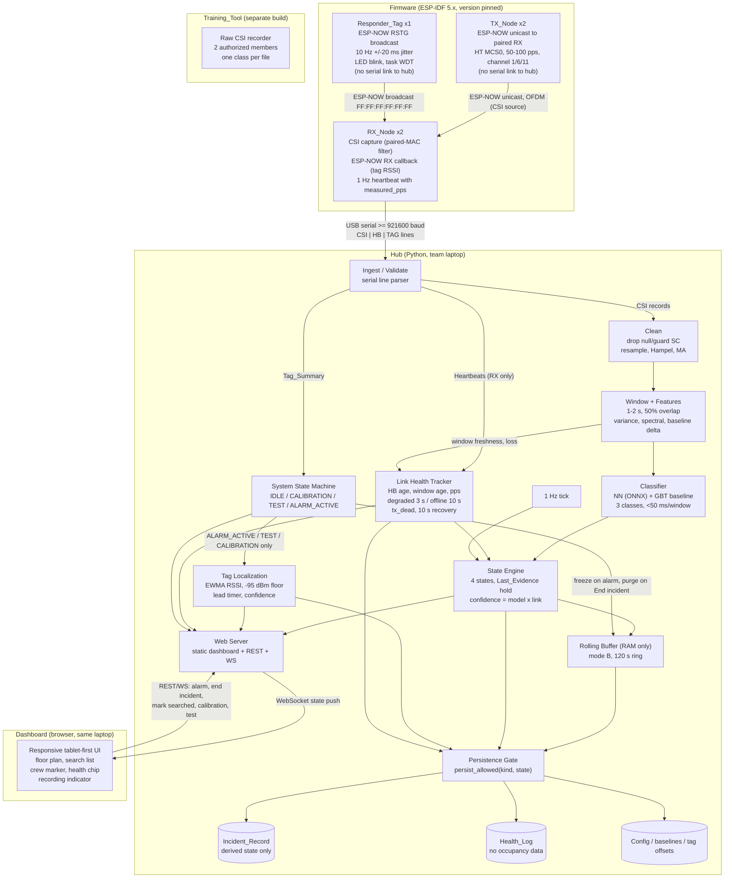
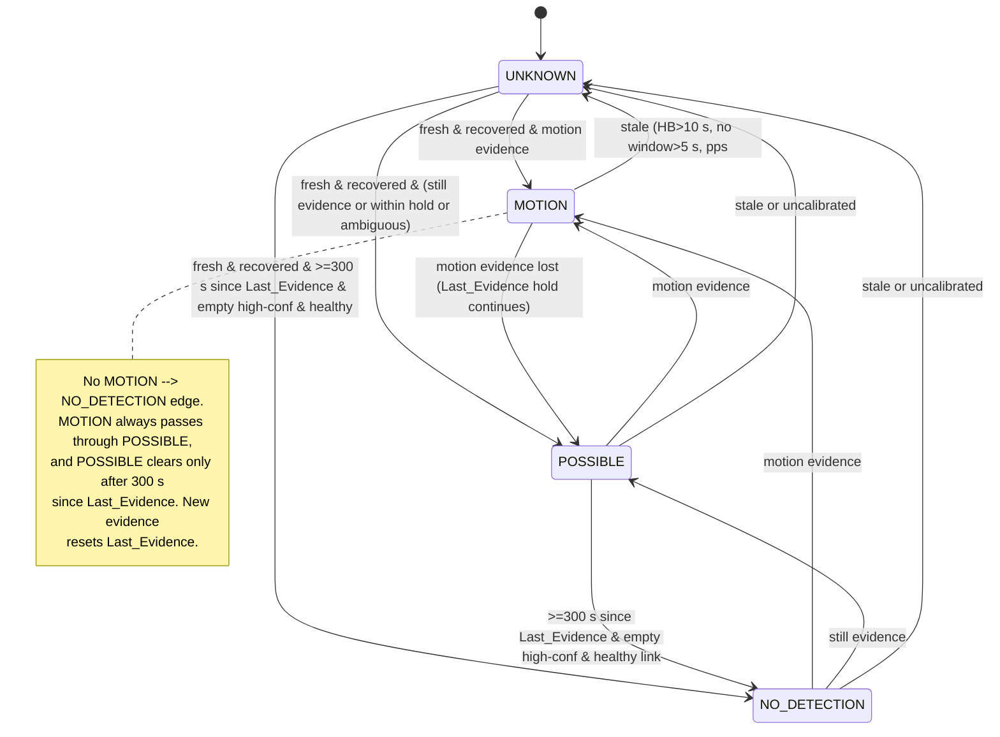
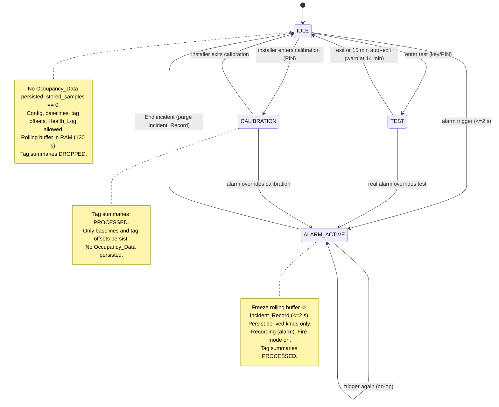

# Design Document

## Overview

RoomSense is an offline network of ESP32 WiFi-sensing nodes that estimates which rooms in a small building are likely still occupied during a fire alarm and presents first responders a prioritized, honest-confidence map. This design implements the 8-hour hackathon build scoped by `requirements.md` (Requirements 1–30), covering the Must and Should tiers, with Could/deferred items noted where they touch the architecture.

The system answers one question — "Is anyone likely still in this room, and how sure are we?" — and deliberately refuses to answer "what does the room look like" or "who is in it." Three design-shaping facts hold throughout:

1. **Hardware (hackathon):** 5 ESP32-WROOM-32E boards — 2 TX, 2 RX, 1 Responder_Tag — covering a 2-room demo, with at most one spare. No router, no internet. Each RX streams to the hub (the team laptop) over USB serial at ≥ 921600 baud. Only RX nodes have a serial link to the hub; TX nodes and the tag have none. TX/RX sensing and the tag all share one fixed 2.4 GHz channel (1, 6, or 11).
2. **Pipeline:** RX CSI → hub ingest/validate → clean → window (1–2 s, 50% overlap) → features → classify (small NN primary, gradient-boosted-tree baseline; three classes empty/moving/still_present; PyTorch → ONNX; < 50 ms per window per link) → state engine (four displayed states, Last_Evidence hold, last-seen, confidence, health; driven by a 1 Hz tick and by windows) → dashboard. A separate tag path (ESP-NOW "RSTG" packets → RX RSSI → `Tag_Summary` serial lines → hub localization) runs alongside and never enters CSI processing.
3. **Safety invariants** that this design must structurally enforce:
   - The interface **never** displays "empty".
   - Unknown/offline **always** sorts before No detection in search priority.
   - Confidence is reported honestly (band high/medium/low plus a percentage) and reflects both model probability and link quality.
   - A room can never silently freeze: a missing heartbeat, missing fresh windows, or a collapsed packet rate all force Unknown/offline within the stated budgets.
   - The system runs **fully offline** after calibration.
   - Privacy: no imagery, audio, or identity; a RAM-only mode-B rolling buffer (120 s); persistence is gated by data kind and system state; the hub build has no raw-CSI write path (raw CSI is recorded only by the separate Training_Tool).
   - Tag localization claims **room-level only** and is honest about ambiguity; it never replaces a PASS device or a full search.

The design favors small, testable pure functions for every safety-relevant decision (state assignment, ranking, confidence, tag switching, persistence gating) so the correctness properties in this document can be exercised with property-based testing. I/O, firmware, and the web layer are kept thin around that pure core.

### Scope markers used in this document

- **[Must]/[Should]** — built for the hackathon demo.
- **[Could]** — designed so the interfaces allow it, implemented only if time permits (per-room tag offsets, "You are here" on a second device, "Mark searched?" suggestion, nearest-room ordering within a tier, 24-hour maximum Incident_Record retention).
- **[Deferred]** — explicitly out of scope (UDP transport, binary serial framing, physical GPIO trigger, body/pose/identity, panel integration, cloud, certification, mode A, CLEARING hold, physical tablet, sub-room position, untagged-people location, downed-responder detection).

## Architecture

The system is three tiers: **firmware** (TX, RX, Responder_Tag), the **hub** (ingest → pipeline → classifier → state engine → tag localization → web server, all on the laptop), and the **dashboard** (browser on the same laptop). The sensing path and the tag path are logically distinct from the RX node onward: the RX's CSI callback accepts only frames from its paired TX MAC, and its ESP-NOW receive callback accepts only "RSTG" tag broadcasts, reads their RSSI, and emits `Tag_Summary` serial lines. The two never mix. A separate **Training_Tool** build (not part of the deployed hub) is the only software that writes raw CSI to disk.



**Data-flow description.**

- **CSI path (Req 1, 2, 4, 5, 8):** the TX sends ESP-NOW unicast packets to its paired RX at HT MCS0. The RX's CSI callback keeps only frames whose source MAC is the paired TX, timestamps them, and writes one CSI line over UART. The hub validates and cleans each record, forms overlapping windows, extracts features normalized against the room's empty baseline, classifies each window into empty/moving/still_present, and feeds probabilities to the state engine.
- **Health path (Req 3, 8.10–8.12, 19, 20):** each RX sends a 1 Hz heartbeat including the measured packet rate from its paired TX. TX health is inferred solely from that measured rate (tx_dead rule); tag health is inferred from the 10 s silence rule. The link health tracker combines heartbeat age, window age, and packet rate. A 1 Hz tick re-evaluates every room even when no windows arrive, so a dead transmitter cannot freeze a room.
- **Tag path (Req 23–30):** the tag broadcasts ESP-NOW "RSTG" packets. Each RX validates magic + commissioned tag ID in its ESP-NOW receive callback, reads RSSI there, and emits one `Tag_Summary` per heard tag per second. The hub processes `Tag_Summary` lines **only in ALARM_ACTIVE, TEST, or CALIBRATION** and drops them in IDLE.
- **Recording path (Req 15, 16, 29):** in IDLE the rolling buffer holds the last 120 s of derived state in RAM, and no Occupancy_Data persists; config, calibration baselines, tag offsets, and the Health_Log may still be written. On alarm the hub enters ALARM_ACTIVE within 2 s, freezes the buffer into the Incident_Record, and persists only allowed derived kinds. "End incident" returns to IDLE and purges the Incident_Record.

## Components and Interfaces

### Firmware: TX_Node (Req 2.1, 3.2–3.5)

**Responsibilities.** Send ESP-NOW unicast packets to the paired RX at a configurable fixed rate (default 50–100 pps) on the fixed channel, at an OFDM PHY rate (HT MCS0) so the RX produces useful CSI; retain node id and room assignment in NVS across reboot; resume transmitting automatically after reboot. The TX has no serial link to the hub during operation and sends **no heartbeats**; its health is inferred by the hub from the paired RX's `measured_pps` (Req 3.5, 19.7).

**Link-layer choice (Req 2.1).** ESP-NOW defaults to a 1 Mbps 802.11b rate, which does not yield useful OFDM CSI, so the TX must set the per-peer rate to HT MCS0. In ESP-IDF 5.x this is done with `esp_now_set_peer_rate_config()`, called after `esp_wifi_start()`, `esp_now_init()`, and `esp_now_add_peer()`. The older `esp_wifi_config_espnow_rate()` is deprecated in 5.x and removed in 6.0 ([Espressif ESP-NOW FAQ](https://docs.espressif.com/projects/esp-faq/en/latest/application-solution/esp-now.html), [ESP-IDF 6.0 Wi-Fi migration guide](https://docs.espressif.com/projects/esp-idf/en/v6.0-beta1/esp32/migration-guides/release-6.x/6.0/wifi.html)). The team pins one ESP-IDF version in hour 0 and verifies the rate API against that version's headers before writing TX firmware.

**Interfaces.**
- Over-the-air: ESP-NOW unicast to the paired RX MAC, HT MCS0, fixed channel. Payload is a small counter frame; content is irrelevant to sensing.
- Serial (setup only, not used at runtime): key/value config lines (`SET node_id=TX1`, `SET room_id=R1`, `SET peer=<rx_mac>`, `SET pps=100`, `SET channel=6`) written to NVS (Req 3.2).

### Firmware: RX_Node (Req 2.2–2.5, 3, 24)

**Responsibilities.** Capture CSI and keep only frames whose source MAC equals the paired TX MAC; timestamp and forward CSI records over UART; count accepted frames per second as `measured_pps`; run an ESP-NOW receive callback that ignores the paired TX's unicast payloads, validates "RSTG" + commissioned tag ID for broadcasts, reads RSSI, and aggregates per-second tag statistics; emit `Tag_Summary` lines; send 1 Hz heartbeats; survive reboot without manual intervention.

**Serial transport and bandwidth (Req 2.4, 2.5) — decided in hour 0–1.** This decision shapes the parser, so it is fixed before any pipeline code is written. ASCII CSI lines are roughly 300–450 bytes, so 100 pps needs 30–45 KB/s per RX. At 115200 baud (≈ 11.5 KB/s) that is impossible. The design runs each RX's UART at **921600 baud** (≈ 92 KB/s at 8N1), consistent with common esp-csi practice, giving headroom for 100 pps ASCII. Each RX has its own USB serial port, so budgets are per link.

| Configuration | Approx. line size | Rate | Load per RX | Share of 115200 (≈ 11.5 KB/s) | Share of 921600 (≈ 92 KB/s) |
|---|---|---|---|---|---|
| L-LTF only (~52 usable subcarriers) | ~300 B | 100 pps | ~30 KB/s | ~260% | ~33% |
| L-LTF + HT-LTF (~114 subcarriers) | ~450 B | 100 pps | ~45 KB/s | ~390% | ~49% |
| L-LTF + HT-LTF | ~450 B | 50 pps | ~22.5 KB/s | ~195% | ~24% |
| Heartbeat + Tag_Summary lines | ~60–80 B | ~2–3 lines/s | < 0.3 KB/s | negligible | negligible |

If measured throughput at 921600 is insufficient (USB-UART bridge limits, host latency), the RX falls back first to **L-LTF-only subcarriers**, then to **50 pps** (Req 2.5). The RX writes only whole lines; if the UART TX queue is full it drops the whole record (visible to the hub as a sequence gap and packet loss), never a partial line, so no record is silently truncated. **Binary framing** (e.g., length-prefixed int8 amplitudes, ~4× smaller) is a [Deferred] option if ASCII proves too heavy. UDP transport is out of scope: it would require joining an access point and leaving the fixed sensing channel.

**Serial line formats (ASCII, newline-terminated, comma-separated; first token is the record type).**

- **CSI record** (`CSI,...`) — Req 2.3:
  ```
  CSI,<node_id>,<tx_mac>,<seq>,<ts_us>,<rssi_dbm>,<channel>,<n_sub>,<amp_0>,<amp_1>,...,<amp_{n_sub-1}>
  ```
  `ts_us` is the RX local timestamp in microseconds; `amp_i` are per-subcarrier amplitudes (phase optional, appended as a second block only if present). Null/guard subcarriers are included as captured; the hub drops them during cleaning.

- **Heartbeat** (`HB,...`) — Req 3.1, 19.2. Sent **only by RX nodes**; contains no CSI or occupancy data:
  ```
  HB,<node_id>,<room_id>,<paired_tx_mac>,<fw_version>,<uptime_ms>,<measured_pps>,<free_heap>
  ```
  `measured_pps` is the count of accepted CSI frames from the paired TX in the last second; it is the sole TX health signal (Req 19.7).

- **Tag_Summary** (`TAG,...`) — Req 24.4:
  ```
  TAG,<node_id>,<room_id>,<tag_id>,<packets_heard>,<mean_rssi>,<max_rssi>
  ```
  Emitted once per second per tag heard; no line is emitted for a tag not heard in that second (Req 24.5). `mean_rssi`/`max_rssi` are integer dBm.

### Firmware: Responder_Tag (Req 23)

**Responsibilities.** Broadcast a ~20-byte `Tag_Packet` via ESP-NOW to `FF:FF:FF:FF:FF:FF` at a configurable default 10 Hz with ±20 ms jitter around the 100 ms interval; operate in station mode on the sensing channel; include magic `"RSTG"`, tag ID, sequence number, uptime ms; blink the onboard LED per packet; enable the task watchdog for auto-reboot. The tag has no serial link to the hub and sends **no heartbeats**; the hub detects a dead tag by the 10 s silence rule (Req 26.6, 30.2).

**Tag_Packet wire layout (~20 bytes).**

| Offset | Field | Size | Notes |
|---|---|---|---|
| 0 | magic | 4 | ASCII `RSTG` |
| 4 | tag_id | 4 | commissioned id, e.g. `"E1\0\0"` |
| 8 | seq | 4 | little-endian uint32 |
| 12 | uptime_ms | 4 | little-endian uint32 |
| 16 | reserved | 4 | zero-filled, future use |

### Hub: Ingest / Validate (Req 4.1, 4.2)

**Responsibilities.** Read serial lines per RX port, dispatch by record type, validate TX MAC (must equal the RX's paired TX) and sequence number for CSI, discard malformed or truncated records, and route `TAG` lines to the system-state gate (never to the CSI path).

**Interface (internal).** `parse_line(raw: str, port_cfg) -> CSIRecord | Heartbeat | TagSummary | None` (None = discarded/malformed).

### Hub: Data Pipeline — Clean, Window, Features (Req 4, 5)

**Responsibilities.** Drop null/guard subcarriers; resample to a fixed rate using record timestamps; apply a Hampel filter then a light moving average; track per-link packet-loss rate; form 1–2 s windows with 50% overlap; flag windows over the loss threshold as low quality; compute the feature set (variance/std per-subcarrier and aggregate, mean amplitude and change vs. baseline, 0.5–5 Hz spectral energy, count of subcarriers over baseline threshold, 10 s/30 s rolling stats, and low-confidence 0.2–0.4 Hz breathing-band energy as supplementary only).

**Interface.** `clean(records) -> CleanStream`; `window(CleanStream) -> Iterator[Window]`; `features(Window, baseline) -> FeatureVector`.

### Hub: Classifier (Req 1, 6)

**Responsibilities.** Run NN inference (ONNX) as primary and GBT as baseline; output probabilities over exactly {empty, moving, still_present} summing to 1.0 ±0.01; complete within 50 ms per window per link; mark a window's result unavailable and retain the last result on overrun; classify each room independently; compute the 5-window smoothed occupied probability. Ship whichever model generalizes better on held-out-room evaluation (Req 6.7).

**Interface.** `classify(features: FeatureVector) -> ClassProbs`; `smoothed_occupied(history: Deque[ClassProbs]) -> float`.

### Hub: Link Health Tracker (Req 3.5, 8.10–8.11, 19, 20)

**Responsibilities.** Per room link, track heartbeat age, fresh-window age, and `measured_pps`; derive the link stage (`ok`, `degraded` at HB > 3 s, `offline` at HB > 10 s or no window > 5 s or pps < minimum); detect transmitter-dead (RX alive, pps < 20% of nominal for 5 s); detect a channel/RSSI discontinuity and open a grace period; enforce 10 s of healthy heartbeats before an offline link is considered recovered; detect tag silence (10 s). Write health events to the Health_Log.

**Interface.** `on_heartbeat(hb, now)`; `on_window(room_id, now, loss_rate)`; `view(room_id, now) -> LinkHealth` with `fresh(now)`, `healthy(now)`, `degraded(now)`, `healthy_for(s, now)`, `in_grace(now)`, `quality(now) -> float in [0,1]`.

### Hub: State Engine (Req 8, 9, 14.3, 19, 20)

**Responsibilities.** Map smoothed class probabilities + link health into exactly one of the four `Room_State` values using the Last_Evidence hold model; run on every classified window **and** on a 1 Hz tick for every room; maintain Last_Seen at 1 s resolution; compute confidence from model probability × link quality; produce search-priority ordering with searched rooms last.

**Interface.** `update(room_id, probs | None, health, now) -> RoomStateView`; `rank(views) -> list[RoomStateView]`.

### Hub: Tag Localization (Req 25, 27, 28, 30)

**Responsibilities.** Maintain per-(tag, room) EWMA RSSI (~2 s time constant) adjusted by per-room offsets; use a −95 dBm floor for rooms that did not hear the tag in the current interval; pick the candidate room; apply the switch rule against the **current** room with an explicit lead timer; compute confidence bands; emit "Near X / Y", "Between rooms", and hollow-marker-after-10 s behaviors; force low confidence when any RX is offline and the leading adjusted RSSI is below −75 dBm.

**Interface.** `on_tag_summary(summary, now)`; `locate(tag_id, now) -> TagLocation`.

### Hub: System State Machine and Persistence Gate (Req 15, 16, 18, 29)

**Responsibilities.** Hold IDLE / CALIBRATION / TEST / ALARM_ACTIVE; maintain the RAM-only rolling buffer; freeze it into the Incident_Record on alarm within 2 s; purge the Incident_Record on "End incident"; gate every disk write by `(data kind, system state)`; gate `Tag_Summary` processing to ALARM_ACTIVE/TEST/CALIBRATION; drive the recording indicator; manage test-mode entry/auth/timeout and the inspection report; manage calibration entry/exit.

**Interface.** `trigger_alarm(now)`, `end_incident(now)`, `enter_test(auth)`, `exit_test()`, `enter_calibration(auth)`, `exit_calibration()`, `tick(now)`, `persist_allowed(kind, state) -> bool`.

### Training_Tool (separate build) (Req 17, 21.5)

**Responsibilities.** A separate Python entry point and package (`training/`), not imported or shipped by the hub, that reads the same serial CSI lines and writes raw CSI to disk, one class label per file, for exactly two authorized team members (local allow-list + PIN), collected only from consenting team members. The hub package contains no code path that writes `CSIRecord` data to disk (Req 17.5, 15.6); this is enforced by a packaging test (see Testing Strategy).

### Hub: Web Server (Req 10, 15.11, 16, 18)

**Responsibilities.** Serve the static dashboard locally (no internet/router); push state over WebSocket; expose the demo alarm trigger, end-incident, mark-searched, calibration, and test endpoints.

**WebSocket message shapes (hub → dashboard, JSON).**

- `room_states`:
  ```json
  {
    "type": "room_states",
    "ts": 1730000000.0,
    "system_state": "ALARM_ACTIVE",
    "simulated": false,
    "rooms": [
      {
        "room_id": "R1",
        "state": "MOTION",
        "label": "MOTION",
        "confidence_band": "high",
        "confidence_pct": 86,
        "last_seen": 1730000000.0,
        "last_evidence": 1730000000.0,
        "stale": false,
        "last_known_state": null,
        "stale_age_s": null,
        "calibrated": true,
        "searched": false,
        "annotation": "responder_present",
        "alarm_time_state": "MOTION",
        "link_health": "ok"
      }
    ],
    "ranking": ["R1", "R2"]
  }
  ```
- `health`:
  ```json
  {
    "type": "health",
    "ts": 1730000000.0,
    "summary": "1 fault",
    "nodes": [
      {"node_id": "RX1", "role": "RX", "room_id": "R1", "status": "ok", "measured_pps": 72},
      {"node_id": "RX2", "role": "RX", "room_id": "R2", "status": "ok", "measured_pps": 9},
      {"node_id": "TX2", "role": "TX", "room_id": "R2", "status": "tx_dead", "inferred_from": "RX2",
       "cause": "RX2 measured packet rate below 20% for 5 s", "action": "check TX2 power"}
    ],
    "tag_faults": [{"tag_id": "E1", "last_room": "R2", "silent_s": 12}]
  }
  ```
- `crew`:
  ```json
  {
    "type": "crew",
    "ts": 1730000000.0,
    "tags": [
      {
        "tag_id": "E1",
        "location_kind": "room",
        "room_id": "R2",
        "near_rooms": [],
        "confidence_band": "high",
        "last_heard_s": 1,
        "marker": "solid",
        "you_are_here": false
      }
    ],
    "floor_crew_counts": {"F1": 1}
  }
  ```
- `recording`:
  ```json
  {"type": "recording", "ts": 1730000000.0, "indicator": "Recording (alarm)", "stored_samples": 128, "fault": null}
  ```

**REST/WS endpoints (dashboard → hub).**

| Method/Channel | Path/Message | Purpose | Requirement |
|---|---|---|---|
| `POST` | `/api/alarm/trigger` | Demo alarm button; IDLE→ALARM_ACTIVE within 2 s; idempotent if already ALARM_ACTIVE; overrides TEST/CALIBRATION | 16.1–16.4, 18.4 |
| `POST` | `/api/incident/end` | "End incident" (responder tap + confirm tap); ALARM_ACTIVE→IDLE, purge Incident_Record | 15.11 |
| `POST` | `/api/rooms/{room_id}/searched` | Mark a room searched (responder tap only) | 9.5, 13.4, 27.6 |
| `POST` | `/api/calibration/enter` | Installer enters CALIBRATION_State from normal mode (PIN) | 15.12, 28.4 |
| `POST` | `/api/calibration/rooms/{room_id}/start` | Run the 30 s empty / walk-through / 30 s still sequence for a room | 7.1–7.3, 28.1–28.3 |
| `POST` | `/api/calibration/exit` | CALIBRATION→IDLE | 15.12 |
| `POST` | `/api/test/enter` | Enter test mode with key/PIN auth (installer screens only) | 18.1, 18.5 |
| `POST` | `/api/test/exit` | TEST→IDLE, produce inspection report | 18.3, 18.7 |
| `POST` | `/api/tag/bind` | Bind a second device to a tag ("You are here") [Could] | 26.4 |
| `WS` | `/ws` | Server pushes the messages above; client may send `{"type":"trigger_alarm"}` / `{"type":"mark_searched","room_id":...}` / `{"type":"end_incident"}` | 10, 15.11, 16 |

`POST /api/alarm/trigger` returns `{"system_state":"ALARM_ACTIVE","simulated":true}`; the dashboard shows a "SIMULATED TRIGGER" label (Req 16.3).

**Security note.** The server binds to `localhost` only. Installer-only endpoints (calibration, test) require the installer PIN; responder endpoints (alarm, end incident, mark searched) are unauthenticated by design for the single-laptop demo. If the [Could] second-device "You are here" path is enabled, the server must also listen on the hotspot interface, which exposes the unauthenticated responder endpoints to any device on that hotspot; the team should use a WPA2-protected hotspot and restrict that listener to read-only crew/room-state data.

### Dashboard (Req 10–14, 26, 27)

**Responsibilities.** Render the floor plan color+icon+label per room; show the search-priority side list in fire mode; crew markers; the persistent health chip, recording indicator, disclaimer, and simulated-data badge; the landing-page alarm button; the "End incident" action; accessibility treatments. (Detailed in the Dashboard design section.)

## Data Models

All models below are plain data (dataclasses / TypedDict on the hub, JSON on the wire). The lifetime column is the privacy contract (Req 15, 19.10, 21, 29).

| Model | Key fields | Lifetime |
|---|---|---|
| **CSIRecord** | `node_id, tx_mac, seq, ts_us, rssi_dbm, channel, amplitudes[]`, optional `phases[]` | RAM only in the hub; disk only in the Training_Tool (Req 15.6, 17, 21.3) |
| **Heartbeat** | `node_id, room_id, paired_tx_mac, fw_version, uptime_ms, measured_pps, free_heap` (RX only) | RAM; derived health events go to the Health_Log (Req 19.2, 19.10) |
| **LinkHealth** | `room_id, last_hb_at, last_window_at, measured_pps, pps_min, stage ∈ {ok, degraded, offline}, tx_dead, healthy_since, grace_until` | RAM |
| **Window** | `room_id, start_ts, end_ts, samples[], low_quality: bool, loss_rate` | RAM only |
| **FeatureVector** | `amp_var[], amp_std[], agg_var, agg_std, mean_amp, baseline_delta, sc_over_baseline, spectral_motion_energy, roll_10s, roll_30s, breathing_band (low-conf)` | RAM only |
| **ClassProbs** | `ts, empty, moving, still_present` (each 0–1, sum 1.0 ±0.01), `low_quality` | RAM only |
| **RoomState** | `room_id, state ∈ {MOTION, POSSIBLE, NO_DETECTION, UNKNOWN}, confidence: Confidence, last_seen, last_evidence, stale, last_known_state, recovering, calibrated, calibrated_at, searched, annotation, history (last 5 ClassProbs)` | RAM; derived snapshots persisted in the Incident_Record only in ALARM_ACTIVE (Req 15.5) |
| **Confidence** | `band ∈ {high, medium, low}, pct: 0–100` | persisted with room state in the Incident_Record |
| **CalibrationRecord** | `room_id, calibrated_at, baseline_mean[], baseline_std[], tag_offset_db, doorway_margin_db` | **persisted** (config); allowed in IDLE/CALIBRATION (Req 7.3, 15.10, 15.12, 29.5) |
| **IncidentRecord** | `incident_id, started_at, per_room_states[], confidence[], timestamps[], health_events[], searched_marks[], tag_positions[]` | **persisted** in ALARM_ACTIVE; purged on End incident; derived only (Req 15.5, 15.11, 29.4) |
| **HealthLogEntry** | `ts, node_id, room_id, event, cause` | **persisted** across incidents in all states; no Occupancy_Data (Req 19.10) |
| **TagPacket** | `magic="RSTG", tag_id, seq, uptime_ms` | on-air / RAM only; never stored |
| **TagSummary** | `node_id, room_id, tag_id, packets_heard, mean_rssi, max_rssi, rx_ts` | RAM only; **dropped in IDLE** (Req 29.2) |
| **LeadTimer** | `candidate_id \| None, since \| None` per tag | RAM |
| **TagLocationEstimate** | `tag_id, location_kind ∈ {room, near, between, lost}, room_id?, near_rooms[], confidence: Confidence, last_heard_s, ewma_by_room{}, current_room, lead_timer` | RAM; `tag_positions` snapshot persisted only in the Incident_Record (Req 29.4) |
| **CrewMarker** | `tag_id, room_id?, marker ∈ {solid, hollow}, last_heard_s, label, you_are_here` | RAM (render model) |
| **RollingBuffer** | ring of the most recent 120 s of derived room-state snapshots | **RAM only**; never displayed, logged, or transmitted until alarm (Req 15.2) |

**Data kinds for the persistence gate.**

| Kind | Occupancy_Data? | IDLE | CALIBRATION | TEST | ALARM_ACTIVE |
|---|---|---|---|---|---|
| `room_state`, `confidence`, `tag_position` | yes | reject + fault | reject + fault | test record only | Incident_Record |
| `csi` | yes | reject + fault | reject + fault | reject + fault | reject + fault (hub has no CSI write path) |
| `timestamp`, `health_event`, `searched_mark` | no | reject (no incident) | reject (no incident) | test record only | Incident_Record |
| `config`, `calibration_baseline`, `tag_offset` | no | allow | allow | allow | allow |
| `health_log` | no | allow | allow | allow | allow |

TEST writes go to a test-tagged record that is discarded when TEST ends; the inspection report contains no occupancy data (Req 18.7). `stored_samples` counts Incident_Record samples and is exactly 0 in IDLE (Req 15.8).

## Detection Model Design

### Primary model (small neural network) — Req 1, 6.1, 6.6

A compact temporal CNN+GRU classifier operating on a window of cleaned, baseline-normalized subcarrier amplitudes (shape `[T_frames, n_subcarriers]`).

- **Conv blocks:** 2 × 1D conv over time (kernel 3–5, 16 then 32 channels) with ReLU + light dropout, extracting local amplitude dynamics per subcarrier group.
- **Recurrence:** a single GRU layer (hidden 32–48) over the conv feature sequence to capture the moving→still temporal signature.
- **Head:** global pooling → dense → **softmax over 3 classes** {empty, moving, still_present}. Softmax guarantees probabilities in [0,1] summing to 1 (Req 1.1), verified with a tolerance of 0.01 after float conversion.
- **Augmentation:** subcarrier dropout and subcarrier-order shuffle during training (Req 6.6), so the network cannot rely on a fixed per-room subcarrier fingerprint.
- **Size/latency:** < 100k parameters, keeping ONNX CPU inference well under the 50 ms/window/link budget (Req 1.3). On overrun the hub marks the window unavailable and keeps the last result (Req 1.6).

**Normalization by empty baseline.** Inputs are normalized against the room's calibrated empty baseline (per-subcarrier mean/std from the 30 s empty recording), so the model sees deviation-from-empty rather than absolute amplitude. This keeps rooms independent (Req 1.4) and helps cross-room transfer, but it does not remove the room fingerprint entirely: a CNN over a fixed subcarrier order can still learn room-specific multipath structure. That is why augmentation is applied and why the GBT baseline on pooled, order-free features is kept as a real shipping option.

### Baseline model (gradient-boosted trees) — Req 6.1, 6.7

A GBT classifier on the hand-crafted, subcarrier-pooled `FeatureVector` (aggregate variance, spectral motion energy, baseline delta, subcarrier-over-threshold count, rolling stats). It is fast, interpretable, and robust with little data. Both models expose the same `classify(features) -> ClassProbs` interface so the state engine is model-agnostic. **If the GBT outperforms the NN on the held-out-room run (train Room 1 → test Room 2), the GBT ships as the live classifier** (Req 6.7).

### Recall-biased decisioning — Req 6.3–6.5

Evaluation prioritizes recall on moving and still_present and reports a confusion matrix, per-class recall, and the false-"empty" rate. The state engine is biased toward **Possible presence over No detection**: still_present ≥ 50% is already evidence, any ambiguous reading out of MOTION or UNKNOWN resolves to POSSIBLE, and No detection requires 300 s without evidence **plus** a high-confidence empty reading **plus** a healthy link.

### ONNX inference on the hub — Req 1.3

The PyTorch NN is exported to ONNX and run with ONNX Runtime (CPU) on the laptop. ONNX decouples training from serving, gives predictable latency, and avoids shipping the training stack into the demo.

### Per-room calibration / fine-tune — Req 7, 28

Calibration runs in CALIBRATION_State and records a 30 s empty baseline, a walk-through, and a 30 s still recording per room (Req 7.1). The empty baseline fits normalization (Req 7.2); the walk-through/still clips optionally set per-room GBT thresholds. The same walk-through, performed while wearing the tag, records per-room tag RSSI offsets and doorway margins (Req 28) [Could]. A room is marked calibrated with a timestamp; uncalibrated rooms render Unknown/offline with an uncalibrated warning (Req 1.5, 7.4). Only baselines and offsets persist in CALIBRATION.

## State Engine and Localization Algorithms

### Room-state model with Last_Evidence hold — Req 8, 14.3, 19.6, 20

Four displayed states: `MOTION` (Motion detected), `POSSIBLE` (Possible presence), `NO_DETECTION` (No detection), `UNKNOWN` (Unknown/offline). "empty" is never a displayed state (Req 8.2). There is one hold mechanism: **Last_Evidence**, the timestamp of the most recent window that met the motion or still threshold. A room stays in POSSIBLE until 300 s have passed since Last_Evidence; any new evidence resets it (Req 8.7). There is no separate hold timer and no lookback, so the hold cannot stack.

Link stages, evaluated by the link health tracker:

| Stage | Condition | Effect |
|---|---|---|
| healthy | HB ≤ 3 s, fresh window ≤ 5 s, pps ≥ min | normal evaluation; required for NO_DETECTION |
| degraded | HB > 3 s (and ≤ 10 s), others fresh | state still evaluated, confidence forced low, NO_DETECTION blocked (Req 8.11, 19.9) |
| offline / stale | HB > 10 s, OR no fresh window > 5 s, OR pps < min | UNKNOWN, stale, last-known state + age shown (Req 8.10, 14.3, 20.1, 20.2) |
| recovering | was offline, now fresh, < 10 s of healthy HBs | UNKNOWN until 10 s healthy (Req 19.6) |



```text
HOLD_S = 300; HB_DEGRADED_S = 3; HB_OFFLINE_S = 10; WINDOW_STALE_S = 5; RECOVERY_S = 10
MOTION_T = 0.80; STILL_T = 0.50; EMPTY_HIGH_T = 0.80

# Called on every classified window (probs != None) AND by a 1 Hz tick for every room
# with probs = None (Req 8.12). Ticks guarantee a room with no windows cannot keep a state.
function update_room(room, probs, health, now):
    if not room.calibrated:
        return unknown(room, warning="uncalibrated")                       # Req 1.5, 7.4

    if probs is not None:                                                  # new window arrived
        room.history.append(probs)                                         # keep last 5
        room.last_seen = floor(now)                                        # 1 s resolution (Req 8.8)

    if not health.fresh(now):          # HB > 10 s OR no fresh window > 5 s OR pps < min
        room.recovering = True
        return unknown(room, stale=True,                                   # Req 8.10, 20.1, 20.2
                       last_known=room.last_known_state, age=now - room.last_seen)

    if room.recovering:                                                    # Req 19.6
        if not health.healthy_for(RECOVERY_S, now):                        # 10 s of healthy HBs
            return unknown(room, stale=False, note="recovering")
        room.recovering = False

    latest = room.history[-1] if room.history else None
    if latest is None:                                                     # e.g. right after hub restart
        return unknown(room, stale=True)                                   # Req 20.3
    if latest.low_quality:                                                 # Req 4.6, 8.13
        return keep(room, confidence=low)
    if health.in_grace(now):                                               # channel change (Req 20.4)
        return keep(room, confidence=low)                                  # never enter MOTION in grace

    good = [p for p in room.history if not p.low_quality]
    motion_ev = count(p.moving >= MOTION_T for p in last(good, 3)) >= 2 \
                or mean(p.moving for p in last(good, 5)) >= MOTION_T      # Req 8.3, anti-flicker
    still_ev  = count(p.still_present >= STILL_T for p in last(good, 3)) >= 2 \
                or mean(p.still_present for p in last(good, 5)) >= STILL_T
    empty_hc  = mean(p.empty for p in last(good, 5)) >= EMPTY_HIGH_T

    if motion_ev:
        room.state = MOTION;   room.last_evidence = latest.ts              # Req 8.3, 8.7
    elif still_ev:
        room.state = POSSIBLE; room.last_evidence = latest.ts              # Req 8.4, 8.7
    elif room.last_evidence is not None and now - room.last_evidence < HOLD_S:
        room.state = POSSIBLE                                              # hold (Req 8.6) — covers "moved, now still"
    elif room.state == MOTION:
        room.state = POSSIBLE                                              # never MOTION -> NO_DETECTION (Req 8.6)
    elif empty_hc and health.healthy(now):                                 # HB <= 3 s, window <= 5 s, pps >= min
        room.state = NO_DETECTION                                          # Req 8.5, 8.15
    elif room.state == UNKNOWN:
        room.state = POSSIBLE                                              # ambiguous on return: bias to presence (Req 6.5)
    # else: keep POSSIBLE or NO_DETECTION

    room.last_known_state = room.state
    room.stale = False
    room.confidence = confidence_from(room, health, now)                   # Req 8.9, 8.11, 8.14
    return view(room)

function confidence_from(room, health, now):
    p_model = { MOTION: mean_moving, POSSIBLE: mean_moving + mean_still,
                NO_DETECTION: mean_empty }[room.state]                     # last 5 good windows
    q_link  = min(1, health.measured_pps / health.pps_nominal)             # packet rate
    pct = round(100 * p_model * q_link)
    if health.degraded(now):                                               # HB > 3 s => low (Req 8.11)
        pct = min(pct, 49)
    band = high if pct >= 80 else medium if pct >= 50 else low
    return {band, pct}
```

`unknown(...)` sets the displayed state to UNKNOWN and forces low confidence but keeps `last_evidence` and `last_known_state`, so the dashboard can show "last known MOTION, 0:12 ago" (Req 14.3), and a room that returns within the hold window still resumes in POSSIBLE. A room entering POSSIBLE from NO_DETECTION or UNKNOWN on still evidence has a fresh Last_Evidence and clears normally 300 s after the last evidence. After a hub restart every room has empty history and no fresh window, so it is UNKNOWN until its first fresh window (Req 20.3).

### Search-priority ranking — Req 9

```text
function rank(views):
    priority = {MOTION: 1, POSSIBLE: 2, UNKNOWN: 3, NO_DETECTION: 4}       # Req 9.1, 9.2
    return sort(views, key = (v.searched,                                  # unsearched first (Req 9.5)
                              priority[v.state],
                              -v.last_seen,                                # more recent first (Req 9.3)
                              v.room_id))                                  # final deterministic tiebreak
```

`UNKNOWN` (priority 3) sorts before `NO_DETECTION` (priority 4), so within each searched/unsearched group every Unknown/offline room appears ahead of every No detection room (Req 9.2). Searched rooms always sort after all unsearched rooms and keep priority order among themselves (Req 9.5). The offline flip and re-rank happen within 10 s of the missed heartbeat because the 1 Hz tick re-evaluates every room (Req 9.4).

### Tag localization algorithm — Req 25, 27, 30

```text
# calibration-tunable starting values (Req 30.3)
LEAD_DB = 6; LEAD_HOLD_S = 2; SILENCE_S = 3; LOST_S = 10
HIGH_LEAD_DB = 10; EWMA_TC_S = 2; FLOOR_DBM = -95; WEAK_DBM = -75; INTERVAL_S = 1.5

function on_tag_summary(s, now):               # only in ALARM_ACTIVE / TEST / CALIBRATION (Req 29.1)
    key = (s.tag_id, s.room_id)
    alpha = 1 - exp(-dt(key, now) / EWMA_TC_S)
    raw = s.mean_rssi + offset(s.room_id)      # per-room offset (Req 25.1, 28)
    ewma[key] = ewma[key] + alpha * (raw - ewma[key]) if key in ewma else raw
    last_heard[key] = now

function adjusted(tag, room, now):             # Req 25.2: floor for rooms silent this interval
    if (tag, room) not in last_heard or now - last_heard[(tag, room)] > INTERVAL_S:
        return FLOOR_DBM
    return ewma[(tag, room)]

function locate(tag, now):
    if tag never heard or now - max_last_heard(tag) >= LOST_S:                # Req 25.7
        return TagLocation(kind=lost, marker=hollow, room=current_room[tag],
                           last_heard_s=now - max_last_heard(tag))           # no extrapolation
    adj  = {r: adjusted(tag, r, now) for r in all_rooms}
    cand = argmax(adj)
    cur  = current_room.get(tag)

    if cur is None:
        current_room[tag] = cand                                              # first fix
    elif cand != cur:
        lead_vs_cur = adj[cand] - adj[cur]                                    # compare to CURRENT room
        if lead_vs_cur >= LEAD_DB:
            if lead_timer[tag].candidate != cand:                             # new candidate -> reset (Req 25.8)
                lead_timer[tag] = (cand, now)
        else:
            lead_timer[tag] = (None, None)                                    # lead not continuous -> reset
        held = lead_timer[tag].candidate == cand and now - lead_timer[tag].since >= LEAD_HOLD_S
        if held or silent(tag, cur, now) >= SILENCE_S:                        # Req 25.3
            current_room[tag] = cand
            lead_timer[tag] = (None, None)
    else:
        lead_timer[tag] = (None, None)

    cur  = current_room[tag]
    lead = adj[cur] - max(adj[r] for r in all_rooms if r != cur)              # lead over EVERY other room

    # confidence (Req 25.4, 30.1)
    if link_degraded(cur, now):
        conf = low
    elif any_rx_offline(now) and adj[cand] < WEAK_DBM:
        conf = low                                                            # Req 30.1
    elif lead >= HIGH_LEAD_DB:
        conf = high                                                           # regardless of rooms hearing
    elif lead >= LEAD_DB:
        conf = medium
    else:
        conf = low

    # presentation honesty (Req 25.5, 25.6)
    if conf == low:
        heard = [r for r in all_rooms if adj[r] > FLOOR_DBM]
        top_lead = adj[cand] - second_highest(adj)
        if len(heard) >= 2 and top_lead < LEAD_DB:
            return TagLocation(kind=between, confidence=low)                  # "Between rooms"
        return TagLocation(kind=near, near_rooms=top2(adj), confidence=low)   # "Near Room X / Room Y"
    return TagLocation(kind=room, room_id=cur, confidence=conf)
```

With the −95 dBm floor, a tag heard only by Room 2 at −60 dBm has a 35 dB lead and reports high confidence even though only one room hears it (Req 25.4). While a switch is pending (candidate ≠ current), the current room's lead is negative, so confidence is low and the UI shows "Near X / Y" rather than a confident wrong room.

**Failure handling (Req 30).** When any RX is offline and the leading adjusted RSSI is below −75 dBm, confidence is forced low and the UI shows "Near X / Y" (Req 30.1). A dead/crashed tag yields a hollow crew marker plus a health-chip tag fault after 10 s of silence (Req 30.2). All thresholds are tunable starting values (Req 30.3).

## Dashboard Design

### Normal mode vs fire mode — Req 11, 13, 14, 15.11

- **Landing page:** the persistent disclaimer, the health chip, the recording indicator, and the **alarm-trigger button** (Req 16.1). Pressing it posts `/api/alarm/trigger`; the UI shows a "SIMULATED TRIGGER" label (Req 16.3).
- **Normal mode:** status overview, node health panel (each RX plus inferred TX status), and calibration controls behind the installer PIN (Req 11.1–11.2). An in-memory event timeline for the current session only, discarded at session end (Req 11.3–11.4).
- **Fire mode:** entered on alarm; switches to the responder view, freezes an alarm-time snapshot, and shows it alongside the live view (Req 14.1). A side list contains only flagged rooms ordered by `rank()` (Req 13.2, 14.2); the highest-priority room is identifiable within 5 s (Req 13.3). No typing is required in fire mode (Req 13.8, 26.5). An "End incident" button (tap + confirm tap) returns to IDLE and purges the Incident_Record (Req 15.11).

### Floor plan, ranking, and interactions — Req 12, 13

Every room is drawn with color **and** icon **and** label, using `MOTION`, `POSSIBLE`, `UNKNOWN`, `NO DETECTION` (Req 12.1). Mark-searched completes in ≤ 2 taps, dims the room, and moves it to the bottom (Req 13.4, 9.5). Floor switch is 1 tap with a per-floor attention count (Req 13.5). Room details open in a bottom sheet ≤ 2 taps away showing state, confidence, last activity, alarm-time state, and link health (Req 13.6). When all flagged rooms are marked searched, the UI reminds that No detection rooms still need a sweep (Req 13.7).

### Crew marker, health chip, recording indicator — Req 19.4, 26, 27

- **Crew_Marker:** distinct icon + tag-ID label, never a room-state color (Req 26.1); shows last-heard age (Req 26.2); hollow after 10 s silent with "Last heard Room 2, 0:40 ago" and no extrapolation (Req 25.7). Per-floor crew counts on floor tabs (Req 26.3).
- **"You are here" [Could]:** the hackathon dashboard runs on the laptop itself. "You are here" needs a second device (for example an iPhone) joined to the laptop's hotspot, preferably on 5 GHz to keep traffic off the 2.4 GHz sensing channel. That device is bound to a tag from a list in normal mode and auto-switches to the tag's floor (Req 26.4).
- **Occupancy interaction labels:** at medium/high tag confidence in a room, Motion is labeled "Motion · responder present" and is **never** downgraded or hidden by tag presence (Req 27.1–27.2). A room left by a responder that holds Possible presence gets a "recent motion may be responder" note without changing state or priority (Req 27.3). The alarm-time snapshot is unaffected by tag presence (Req 27.4). After 20 s dwell in a flagged room, a tap-required "Mark searched?" suggestion appears in the detail sheet (Req 27.5–27.6) [Could].
- **Health_Chip:** header summary ("All sensors online" / "2 faults") that opens a fault list with cause + suggested action (Req 19.4). Faults include RX degraded (HB > 3 s), RX offline (HB > 10 s), no fresh windows, TX dead (inferred from the RX's measured_pps), and tag silent 10 s naming the tag and last-heard room (Req 26.6, 30.2). A hub-lost banner (full width) shows if the hub is unreachable for 5 s (Req 19.8).
- **Recording_Indicator:** always visible; "Not recording" (IDLE and CALIBRATION), "Recording (alarm)" (ALARM_ACTIVE), "Recording (test)" (TEST) (Req 15.1, 15.3, 15.7, 18.2).

### Accessibility — Req 12

Every state is grayscale-distinguishable (shape/fill/pattern differs, not only hue) (Req 12.2); icon + label always accompany color (Req 12.1); interactive targets ≥ 56 px (Req 12.3); high-contrast, outdoor-readable text (Req 12.4). Full WCAG validation requires manual testing with assistive technologies; the demo build covers these specific checks only.

### Simulated-data badge — Req 10.5

Whenever displayed states derive from replayed/simulated data the `Simulated_Data_Badge` is shown; the `simulated` flag on `room_states` drives it.

## System / Recording State Machine



```text
OCCUPANCY      = {room_state, confidence, tag_position, csi}
INCIDENT_KINDS = {room_state, confidence, tag_position, timestamp, health_event, searched_mark}
ALWAYS_OK      = {config, calibration_baseline, tag_offset, health_log}

function persist_allowed(kind, state):                  # Req 15.1, 15.5, 15.6, 15.9, 15.10, 15.12, 29.5
    if kind in ALWAYS_OK:
        return True
    if kind == csi:                                     # hub has no CSI write path (Req 15.6, 17.5)
        raise_policy_violation_fault(kind, state); return False
    if kind in INCIDENT_KINDS and state in {ALARM_ACTIVE, TEST}:
        return True                                     # Incident_Record (or TEST record)
    if kind in OCCUPANCY:                               # IDLE or CALIBRATION
        raise_policy_violation_fault(kind, state)       # visible fault (Req 15.9)
    return False                                        # rejected; storage unchanged

function trigger_alarm(now):
    if state == ALARM_ACTIVE:
        return                                          # idempotent (Req 16.4)
    state = ALARM_ACTIVE                                # from IDLE, TEST, or CALIBRATION; within 2 s
    incident = freeze(rolling_buffer)                   # within 2 s (Req 15.3, 15.4)
    recording_indicator = "Recording (alarm)"
    fire_mode = True

function end_incident(now):                             # responder tap + confirm (Req 15.11)
    if state != ALARM_ACTIVE:
        return
    purge(incident)                                     # hackathon retention policy: purge on end
    incident = None; stored_samples = 0
    state = IDLE; fire_mode = False
    recording_indicator = "Not recording"

function on_tag_summary(s, now):
    if state not in {ALARM_ACTIVE, TEST, CALIBRATION}:
        drop(s); return                                 # Req 29.2
    localization.on_tag_summary(s, now)                 # Req 29.1
```

The hackathon retention policy is purge-on-End-incident. The [Could] 24-hour maximum retention is a cap for builds that keep the record after End incident for review; it is not used in the demo.

Test mode requires key/PIN (Req 18.1), shows an amber TEST MODE banner and "Recording (test)" (Req 18.2), auto-exits after 15 min with a 1-minute warning (Req 18.3), is unreachable from responder screens (Req 18.5), supports the node-down test (Unknown/offline + fault within 10 s, Req 18.6), and on exit produces a printable inspection report (date/time, inspector, node list, health values, trigger result, calibration dates) that excludes occupancy data (Req 18.7). CALIBRATION is entered and exited from normal mode by an installer; the recording indicator reads "Not recording" because no Occupancy_Data persists there (Req 15.12).

## Correctness Properties

*A property is a characteristic or behavior that should hold true across all valid executions of a system — essentially, a formal statement about what the system should do. Properties serve as the bridge between human-readable specifications and machine-verifiable correctness guarantees.*

These properties are executed as property-based tests against the hub's pure decision functions (and host-side ports of firmware predicates). Each references the requirement(s) it protects. Firmware timing, UI measurement, and external wiring are covered by example, integration, and smoke tests in the Testing Strategy.

### Property 1: Class probabilities form a valid simplex

*For any* feature vector passed to the classifier, each of the three class probabilities {empty, moving, still_present} is in [0.0, 1.0] and the three sum to 1.0 within a tolerance of 0.01.

**Validates: Requirements 1.1**

### Property 2: Smoothed occupied probability matches the 5-window mean

*For any* history of valid class-probability outputs, the smoothed occupied probability equals the mean of (moving + still_present) over the most recent 5 windows (or all windows if fewer) and lies in [0.0, 1.0].

**Validates: Requirements 1.2**

### Property 3: Room classification is independent

*For any* two rooms' window streams, a room's class probabilities and Room_State sequence are identical whether the other room's windows are absent or interleaved in any order.

**Validates: Requirements 1.4**

### Property 4: Serial records and tag packets round-trip

*For any* valid CSI record, RX heartbeat, or Tag_Summary, formatting it to its serial line and parsing it back yields an equivalent record with all fields in the defined order; and *for any* Tag_Packet, encoding then decoding the ~20-byte payload yields an equivalent packet (magic "RSTG", tag ID, sequence, uptime).

**Validates: Requirements 2.3, 3.1, 23.4, 24.4**

### Property 5: Every CSI record comes from the paired TX

*For any* interleaved stream of received frames (paired-TX unicasts, tag broadcasts, and frames from other MACs), every CSI record emitted by the RX filter has a source MAC equal to that RX's paired TX MAC, so tag traffic never enters CSI processing.

**Validates: Requirements 2.2, 24.2**

### Property 6: Ingest accepts valid records and discards malformed ones

*For any* input line, a malformed or truncated record (unknown type token, wrong field count, non-numeric field, TX MAC not equal to the paired TX, or invalid sequence number) is discarded, and *for any* well-formed record the parser returns a typed record whose fields match the input.

**Validates: Requirements 2.5, 4.1, 4.2**

### Property 7: Windows preserve duration and 50% overlap

*For any* timestamped sample stream, every analysis window has a duration between 1 and 2 seconds and each consecutive pair of windows overlaps by 50%.

**Validates: Requirements 4.5**

### Property 8: Low-quality windows are flagged and never change the state

*For any* sequence-numbered record stream, a window is flagged low quality exactly when its computed loss rate (missing sequence numbers over expected) exceeds the configured threshold; and *for any* room receiving a low-quality window, its Room_State is unchanged and its Confidence band is low.

**Validates: Requirements 4.4, 4.6, 8.13**

### Property 9: Displayed state is always one of four, never "empty"

*For any* combination of window history, link health, calibration status, and time, the state engine assigns exactly one state from {MOTION, POSSIBLE, NO_DETECTION, UNKNOWN} with its matching label, never "empty", and an uncalibrated room is always UNKNOWN.

**Validates: Requirements 1.5, 8.1, 8.2, 12.1**

### Property 10: Evidence sets the state and resets Last_Evidence

*For any* fresh, recovered, non-grace room: when the smoothed moving evidence meets 80% the state is MOTION, otherwise when the smoothed still_present evidence meets 50% the state is POSSIBLE; and in both cases Last_Evidence equals the timestamp of the latest window.

**Validates: Requirements 6.5, 8.3, 8.4, 8.7**

### Property 11: The hold never drops to No detection early or directly from Motion

*For any* sequence of windows and ticks, no update moves a room directly from MOTION to NO_DETECTION, and a room is never NO_DETECTION at a time less than 300 s after its Last_Evidence; in particular a moving-then-still sequence yields POSSIBLE.

**Validates: Requirements 8.6, 22.2**

### Property 12: Possible presence always clears when the conditions hold (liveness)

*For any* room in POSSIBLE whose Last_Evidence is at least 300 s old, whose recent good windows read empty with high confidence, and whose link is healthy (HB ≤ 3 s, fresh window ≤ 5 s, pps ≥ minimum), the next update sets the room to NO_DETECTION.

**Validates: Requirements 8.5, 8.15**

### Property 13: Heartbeat age drives degraded and offline stages

*For any* room and heartbeat history, if the last RX heartbeat is more than 3 s old the Confidence band is low and the room is not NO_DETECTION by a new transition, and if it is more than 10 s old the room is UNKNOWN, marked stale, and carries its last-known state and age.

**Validates: Requirements 8.10, 8.11, 14.3, 19.3, 19.9, 20.1, 22.4**

### Property 14: No fresh window or a low packet rate makes a room Unknown, even without windows

*For any* room driven only by 1 Hz ticks (including after a hub restart), if no fresh classified window has arrived for more than 5 s, or the measured packet rate is below the configured minimum, the room is UNKNOWN and marked stale, regardless of its earlier state or heartbeat freshness.

**Validates: Requirements 8.10, 8.12, 20.2, 20.3**

### Property 15: A returning node stays Unknown until 10 s of healthy heartbeats

*For any* room whose link was offline and then becomes fresh again, the room remains UNKNOWN until heartbeats have been continuously healthy for at least 10 s, and is evaluated normally afterward.

**Validates: Requirements 19.6**

### Property 16: Confidence is consistent and reflects link quality

*For any* room state, the Confidence percentage is in [0, 100], the band is high for ≥ 80, medium for 50–79, and low for < 50; lowering the measured packet rate or aging the heartbeat never raises the percentage; and a heartbeat older than 3 s always yields band low.

**Validates: Requirements 8.9, 8.11, 8.14**

### Property 17: Transmitter-dead is inferred only from the RX packet rate

*For any* stream of RX heartbeats, a tx_dead fault is raised exactly when the RX is alive and its measured packet rate has been below 20% of nominal for at least 5 s, and the absence of TX or tag heartbeats never raises a fault.

**Validates: Requirements 3.5, 19.7**

### Property 18: Search-priority ranking is correct and Unknown sorts before No detection

*For any* set of unsearched room views, the ranking orders rooms MOTION, POSSIBLE, UNKNOWN, NO_DETECTION, breaks ties by more recent Last_Seen first and then by room ID, and places every UNKNOWN room before every NO_DETECTION room; the fire-mode side list contains exactly the flagged rooms in this order.

**Validates: Requirements 9.1, 9.2, 9.3, 9.4, 13.2, 14.2, 19.5**

### Property 19: Searched rooms rank after all unsearched rooms

*For any* set of room views with arbitrary searched flags, every searched room appears after every unsearched room, and within each group the order matches the Property 18 ordering.

**Validates: Requirements 9.5, 13.4**

### Property 20: The alarm-time snapshot is immutable

*For any* sequence of state updates, tag events, and searched marks applied after the alarm is triggered, the frozen alarm-time snapshot is unchanged.

**Validates: Requirements 14.1, 27.4**

### Property 21: The rolling buffer holds at most the last 120 seconds

*For any* sequence of derived-state snapshots appended in IDLE, the rolling buffer contains only snapshots no older than 120 s relative to the newest, and appending never writes to disk.

**Validates: Requirements 15.2**

### Property 22: Persistence is gated by data kind and system state

*For any* data kind and system state, `persist_allowed` returns true for config, calibration baselines, tag offsets, and Health_Log in every state; rejects every Occupancy_Data kind (room state, confidence, tag position, CSI) in IDLE and CALIBRATION, raising a visible policy-violation fault and leaving storage unchanged; and the stored-samples counter is exactly 0 throughout IDLE.

**Validates: Requirements 15.1, 15.8, 15.9, 15.10, 15.12, 19.10, 29.5**

### Property 23: Persisted and transmitted payloads contain only allowed fields

*For any* Incident_Record, inspection report, Health_Log entry, heartbeat, or outbound WebSocket message, the payload contains only its allowed fields (derived room state, confidence, timestamps, health events, searched marks, tag positions for the Incident_Record; no occupancy data for the report, Health_Log, and heartbeat) and never raw CSI, identity, imagery, or audio; and tag positions appear on disk only inside the Incident_Record.

**Validates: Requirements 15.5, 15.6, 18.7, 19.2, 21.1, 21.3, 29.4**

### Property 24: Alarm triggering reaches ALARM_ACTIVE and is idempotent

*For any* starting system state (IDLE, TEST, or CALIBRATION) and any number of repeated triggers, the resulting state is ALARM_ACTIVE with exactly one Incident_Record, identical to the result of a single trigger.

**Validates: Requirements 16.2, 16.4, 18.4**

### Property 25: End incident returns to IDLE and leaves no Incident_Record

*For any* incident history in ALARM_ACTIVE, invoking End incident yields IDLE, no Incident_Record on disk, a stored-samples counter of 0, and the "Not recording" indicator; the Health_Log is retained.

**Validates: Requirements 15.11**

### Property 26: No room enters Motion during a channel-change grace period

*For any* window and tick sequence, while a detected channel or RSSI discontinuity's grace period is active, no room transitions into MOTION.

**Validates: Requirements 20.4**

### Property 27: Tag broadcast intervals stay within the jitter bound

*For any* sequence of jitter draws, every interval between consecutive Tag_Packet sends is between 80 ms and 120 ms.

**Validates: Requirements 23.2**

### Property 28: Only RSTG packets with commissioned tag IDs are accepted and located

*For any* received broadcast, it is accepted exactly when it carries the magic "RSTG" and a commissioned tag ID; every other broadcast is rejected and never produces a Tag_Summary or Tag_Location.

**Validates: Requirements 24.1, 29.3**

### Property 29: Tag_Summary is emitted exactly for tags heard in that second

*For any* one-second set of accepted tag packets, the RX emits one Tag_Summary per distinct tag heard, whose packets_heard, mean_rssi, and max_rssi match the packets for that tag, and emits none for unheard tags.

**Validates: Requirements 24.4, 24.5**

### Property 30: Tag summaries are processed only in ALARM_ACTIVE, TEST, or CALIBRATION

*For any* Tag_Summary stream and system-state sequence, summaries received in IDLE are dropped and produce no localization update and no persistence, and summaries received in ALARM_ACTIVE, TEST, or CALIBRATION update localization.

**Validates: Requirements 29.1, 29.2**

### Property 31: The candidate room is the argmax of adjusted RSSI with a −95 dBm floor

*For any* set of Tag_Summaries and per-room offsets, each heard room's smoothed value equals the EWMA of offset-adjusted RSSI, every room silent in the current interval is assigned −95 dBm, and the candidate room is the room with the highest resulting value.

**Validates: Requirements 25.1, 25.2**

### Property 32: The lead timer gates room switching

*For any* sequence of adjusted RSSI values over time, the Tag_Location switches from the current room to a new room only when the same candidate has led the current room by at least 6 dB continuously for at least 2 s, or the current room has not heard the tag for at least 3 s; a change of candidate or a lapse in the lead resets the timer.

**Validates: Requirements 25.3, 25.8**

### Property 33: Tag confidence follows the lead-over-every-room rule

*For any* adjusted RSSI map (floor applied) with a healthy leading link and no weak-signal override, confidence is high when the located room leads every other room by at least 10 dB regardless of how many rooms hear the tag, medium when that lead is 6–10 dB, and low otherwise; a degraded leading link always yields low.

**Validates: Requirements 25.4**

### Property 34: Low tag confidence never resolves to a single room

*For any* localization input yielding low confidence — including every input where any RX is offline and the leading adjusted RSSI is below −75 dBm — the Tag_Location is "Near Room X / Room Y" or "Between rooms" and never a single room.

**Validates: Requirements 25.5, 30.1**

### Property 35: Weakly heard with no lead resolves to "Between rooms"

*For any* low-confidence input where at least two rooms hear the tag and no room leads the next by 6 dB, the Tag_Location is "Between rooms".

**Validates: Requirements 25.6**

### Property 36: A tag unheard for 10 s shows a hollow last-heard marker and a fault

*For any* tag whose most recent reception is at least 10 s old, the Crew_Marker is hollow with the last-heard room and elapsed time, no current single-room position is extrapolated, and the Health_Chip lists a fault naming the tag and its last-heard room.

**Validates: Requirements 25.7, 26.6, 30.2**

### Property 37: The Crew_Marker never uses a room-state color

*For any* Tag_Location rendered as a Crew_Marker, the marker uses the crew icon and the tag-ID label, and its color is never one of the four room-state colors.

**Validates: Requirements 26.1**

### Property 38: Per-floor crew counts match located tags

*For any* set of located tags across floors, each floor tab's crew count equals the number of non-lost tags located on that floor.

**Validates: Requirements 26.3**

### Property 39: Responder presence never changes occupancy state or priority

*For any* room and any tag presence history, the Room_State and its rank are identical to those computed with no tags; tag presence only adds the "responder present" label to MOTION at medium/high tag confidence or the "recent motion may be responder" note to POSSIBLE.

**Validates: Requirements 27.1, 27.2, 27.3**

### Property 40: No room is ever marked searched automatically

*For any* sequence of tag-dwell, timing, and state events without a mark-searched request, every room's searched flag remains false.

**Validates: Requirements 27.6**

### Property 41: Evaluation holds out entire sessions

*For any* list of labeled recording sessions, the evaluation splitter produces train and test sets with no session identifier in both.

**Validates: Requirements 6.2**

## Error Handling

The hub is defensive at every boundary and surfaces faults within the 10 s visibility budget (Req 19.3, 20). The 1 Hz tick ensures every rule below fires even when no data arrives.

- **Malformed / truncated input:** malformed or partial lines are discarded at ingest (Req 4.2); RX firmware drops whole records rather than truncating when the UART queue is full (Req 2.5), which the hub sees as packet loss.
- **Low-quality windows:** windows over the loss threshold are flagged; the state engine keeps the room's current state and forces low confidence (Req 4.6, 8.13).
- **Inference overrun:** a window exceeding 50 ms is marked unavailable and the last successful result is retained (Req 1.6).
- **Degraded link (HB > 3 s):** the RX is marked degraded, the room's confidence is forced low, and NO_DETECTION transitions are blocked (Req 8.11, 19.9).
- **Offline / stale (HB > 10 s, no fresh window > 5 s, or pps < minimum):** the room flips to UNKNOWN, marked stale, showing last-known state and age, ranked before No detection; a plain-language fault appears in the health chip (Req 8.10, 14.3, 19.3, 19.5, 20.1, 20.2).
- **Recovery:** a returning link stays UNKNOWN until 10 s of healthy heartbeats (Req 19.6).
- **Transmitter-dead:** RX alive with measured pps below 20% of nominal for 5 s reports "TX dead" with a suggested action; this is the only TX health signal since TX nodes send no heartbeats (Req 3.5, 19.7).
- **Hub lost / restart:** the dashboard shows a full-width hub-lost banner after 5 s without hub contact (Req 19.8); on restart the pipeline resumes from live data, the timeline resets, and all rooms are UNKNOWN until fresh windows arrive (Req 20.3).
- **Channel change:** a change in the reported channel or an abrupt RSSI/CSI discontinuity is flagged and opens a grace period during which no room may enter MOTION and confidence is low (Req 20.4); persistent baseline drift raises a recalibration flag (Req 20.5).
- **Policy violation:** any Occupancy_Data write in IDLE or CALIBRATION, and any CSI write in any state, is rejected with storage unchanged and raises a visible fault (Req 15.9).
- **Tag failures:** any RX offline with leading adjusted RSSI below −75 dBm forces low confidence and "Near X / Y" (Req 30.1); a tag silent 10 s yields a hollow marker and a health-chip fault naming the tag and last-heard room (Req 26.6, 30.2). Tags enable the task watchdog (Req 23.6); RX/TX resume automatically after reboot (Req 3.3).

All faults are expressed in plain language with a cause and a suggested action in the health chip's fault list (Req 19.4).

## Testing Strategy

A dual approach: property-based tests cover the universal correctness properties above; example, edge-case, integration, and smoke tests cover concrete behavior, timing, UI, firmware, and the evaluation methodology.

### Property-based tests

- **Library:** [Hypothesis](https://hypothesis.readthedocs.io/) with pytest for the Python hub. Firmware predicates (paired-MAC filter, tag-accept predicate, tag-summary aggregation, jitter generator, packet layout) are ported host-side to small pure Python functions mirroring the C logic and tested with Hypothesis; PBT is not implemented from scratch.
- **Coverage:** every property in the Correctness Properties section is implemented by a **single** property-based test.
- **Iterations:** each property test runs a minimum of 100 generated examples (`@settings(max_examples=100)` or higher).
- **Tagging:** each test carries a comment in the form **Feature: roomsense-occupancy-tool, Property {number}: {property_text}**.
- **Time:** state-engine and localization tests use an injected clock, so 300 s holds, 10 s recovery, and 2 s lead timers are exercised in microseconds.
- **Generators:** `ClassProbs` on the simplex; window/tick sequences with controlled gaps; heartbeat streams with variable ages and pps; mixed CSI/tag/foreign-MAC frame streams; `TagSummary` streams with varied RSSI, offsets, silence, and lead; system-state and data-kind pairs. Generators deliberately include boundary values: heartbeat ages of exactly 3 s and 10 s, window age exactly 5 s, holds of exactly 300 s, leads of exactly 6 and 10 dB, RSSI exactly −75 and −95 dBm, empty histories, and truncated serial lines.

### Example, edge-case, integration, and smoke tests

- **Examples:** calibration completes and marks the room calibrated with a timestamp (Req 7); both NN and GBT load and classify (Req 6.1); feature functions match a NumPy reference on fixed inputs (Req 5); disclaimer, recording indicator, and simulated badge always render (Req 10.3, 10.5, 15.7); the four states render with icon + label and distinct grayscale treatment (Req 12.1, 12.2); no auto-dispatch (Req 14.4); test mode auth, banner, and 15-minute auto-exit with 14-minute warning on an injected clock (Req 18.1–18.3); "Mark searched?" suggestion after 20 s dwell (Req 27.5); thresholds read from config (Req 30.3).
- **Packaging smoke:** a test imports the hub package and statically scans it for any file-write call reachable with a `CSIRecord`, and asserts the `training/` package is not imported by the hub (Req 15.6, 17.5).
- **Edge cases:** inference overrun retains last result (Req 1.6); RX UART queue full drops whole lines (Req 2.5).
- **Integration (1–3 representative runs):** offline serving with networking disabled (Req 10.1); 921600 baud sustained throughput at the configured pps with the bandwidth table re-measured (Req 2.4, 2.5); 10 s offline detection, 5 s tx-dead, 5 s hub-lost timings on hardware (Req 19.3, 19.7, 19.8); node-down test in TEST mode (Req 18.6); no outbound network calls from the hub (Req 21.2); reboot retains config and resumes streaming (Req 3.3, 3.4); inference latency benchmark under 50 ms (Req 1.3).
- **Smoke (on-device):** TX ESP-NOW unicast at HT MCS0 on the configured channel produces CSI at the RX, verified against the pinned ESP-IDF version (Req 2.1); tag 10 Hz rate, LED blink, and task watchdog (Req 23.1, 23.5, 23.6); RSSI populated in the ESP-NOW callback (Req 24.3).

### Session- and room-held-out evaluation — Req 6.2–6.7, 22

- **Session hold-out:** entire recording sessions are held out of training (Property 41). Reports always include the confusion matrix, per-class recall, the false-"empty" rate, and the test conditions (Req 6.3, 22.5). The primary metric prioritizes recall on moving and still_present (Req 6.4).
- **Room generalization:** train on Room 1 data, evaluate on Room 2 data, and report the result (Req 22.6). Baseline normalization helps but does not stop a CNN over a fixed subcarrier order from learning a room fingerprint, so the NN is trained with subcarrier dropout/shuffle (Req 6.6). If the GBT on pooled features generalizes better on this run, the GBT ships as the live classifier (Req 6.7).
- **Person generalization:** train on two people, test on a third (Req 22.3).
- **Behavioral checks:** moving-then-still yields POSSIBLE (Req 22.2, Property 11); a failed node yields UNKNOWN within the offline threshold (Req 22.4, Properties 13–14); empty vs occupied on held-out sessions (Req 22.1).

## Technology and Library Choices

Chosen for an 8-hour offline build with the hardware on hand.

- **Firmware (TX/RX/Tag):** [ESP-IDF 5.x](https://docs.espressif.com/projects/esp-idf/en/stable/esp32/) in C on ESP32-WROOM-32E, pinned to one exact version in hour 0. ESP-IDF gives the CSI callback, ESP-NOW (including per-peer rate config for HT MCS0 on the TX), RSSI in the ESP-NOW receive callback, NVS for reflash-free config (Req 3.2), and the task watchdog (Req 23.6).
- **Transport:** USB serial (UART) at 921600 baud as the only RX→hub transport, so reporting never competes with the sensing radio (Req 2.4). ESP-NOW unicast (TX→RX) and broadcast (tag) on a fixed 2.4 GHz channel, needing no router (Req 2.1, 23.1, 23.3). UDP and binary framing are deferred.
- **Hub pipeline & logic:** Python 3.11+ with `pyserial`. NumPy/SciPy for cleaning (Hampel, moving average, resampling), windowing, and feature extraction. The safety-critical logic (link health, state engine, ranking, confidence, tag localization, system state machine, persistence gate) is plain Python pure functions with an injected clock.
- **Detection model:** [PyTorch](https://pytorch.org/) for training the small CNN+GRU, exported to [ONNX](https://onnx.ai/) and served with [ONNX Runtime](https://onnxruntime.ai/) (CPU) (Req 1.3). Gradient-boosted baseline via scikit-learn or XGBoost (Req 6.1).
- **Web stack:** [FastAPI](https://fastapi.tiangolo.com/) + Uvicorn bound to `localhost`, serving a static, framework-light dashboard with no CDN or external assets, pushing state via WebSocket (Req 10).
- **Training_Tool:** separate `training/` package and entry point sharing only the serial parser with the hub (Req 17).
- **Testing:** [Hypothesis](https://hypothesis.readthedocs.io/) + pytest; a serial-replay simulator drives the full hub without hardware and powers the simulated-data path with the on-screen badge (Req 10.5).

Dependencies are pinned to exact versions in `requirements.txt`. Deferred technology (noted, not built): physical GPIO/dry-contact trigger wiring, panel integration, cloud/accounts, and a dedicated tablet deployment (Req 16.5, and the deferred list in the Overview).
