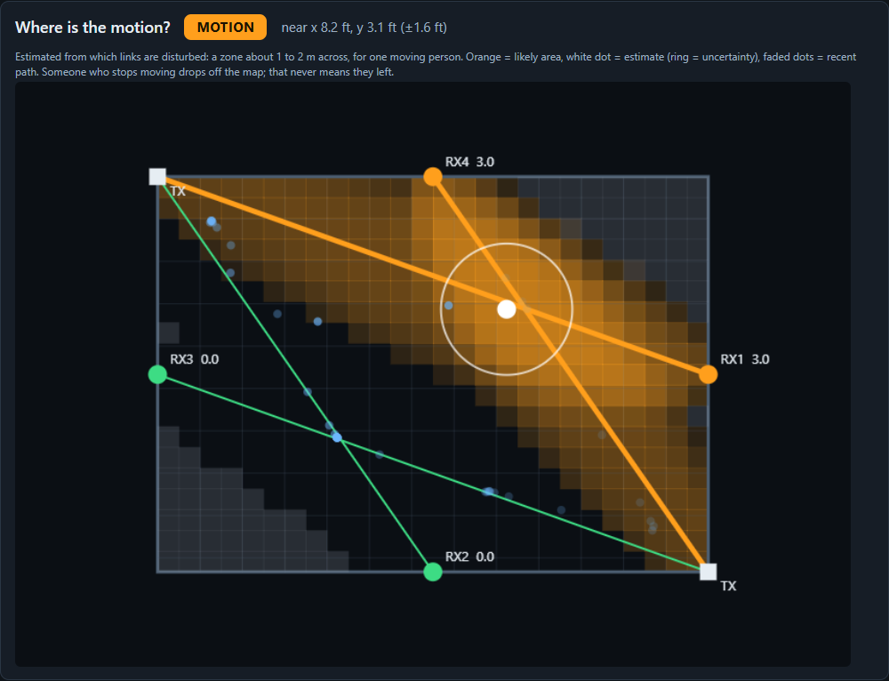
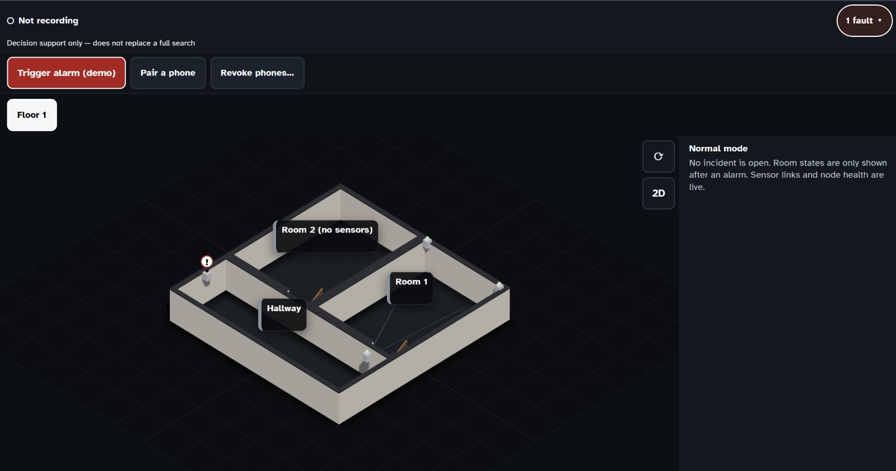
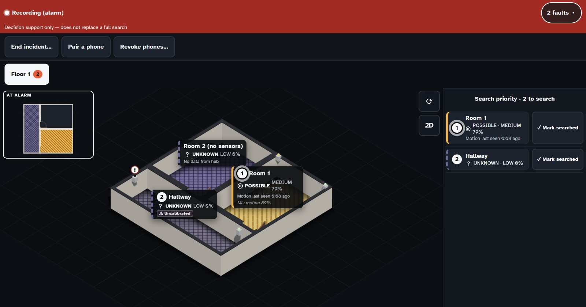
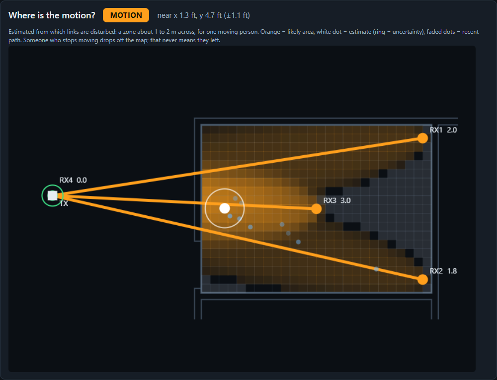
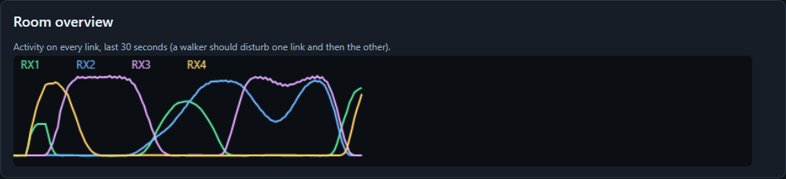
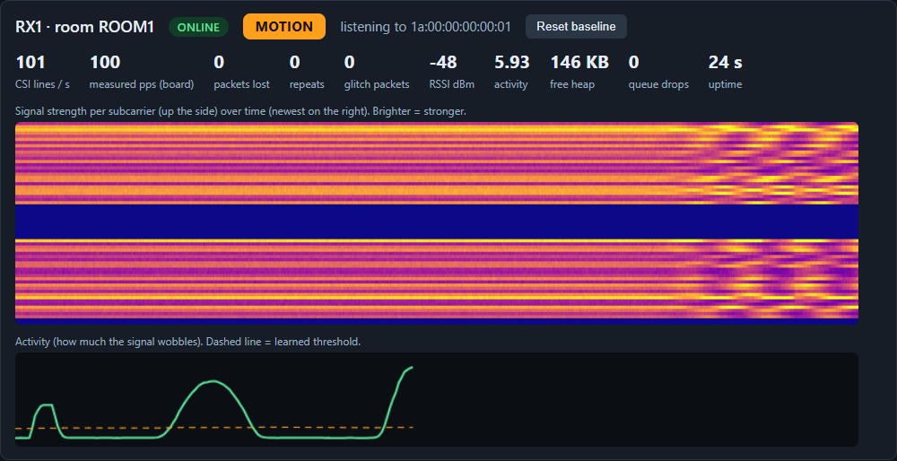

# Beacon

_Last updated: 2026-10-24._
**WiFi sensing that tells firefighters which rooms to search first.**

Hackachusetts entry, **Civic Action** track (theme V2, *Responsive and resilient communities*). Inside the code the system is called **RoomSense**. You will see that name in the firmware, the Python packages and the specs.



*`rs-view` (the board viewer) running on simulated receivers. Two radio links (orange) are disturbed, so the viewer shades the likely area and puts its estimate (white dot) where they cross.*

---

## The Problem

When a fire alarm sounds, most people leave. Firefighters then search room by room, often in heavy smoke, without knowing which rooms to search first. The people still inside are usually the ones who can't call for help: people who are asleep, unconscious, injured, have limited mobility, or are hiding (as children often do). Cameras are blinded by smoke and unacceptable in bedrooms and restrooms, wearables only help people carrying them, and manual searches are slow, dangerous, and ordered by guesswork.

## The Solution

Beacon is a network of low-cost ESP32 nodes that detects human movement through smoke and walls from disturbances in WiFi signals (channel state information), with no cameras, microphones, or devices for occupants to carry.

- **Activates on alarm.** It connects to the fire panel's relay output. In the demo, a button stands in for the relay.
- **Flags rooms that need searching.** Each room shows Motion, Possible presence, No detection, or Unknown. A room where someone was moving and then went still stays flagged as possible presence, which catches people who collapsed or are trapped.
- **Guides the search.** Firefighters see live room states on the building's floor plan, with a priority list of rooms to search first.
- **Keeps working if parts fail.** Each node runs its own detection model, so room states still reach a display at the entrance if the main computer goes down.
- **Private by design.** Nothing is shown or saved until an alarm, and raw signal data stays on the node.

**Who it helps:** incident commanders and search crews, occupants who can't help themselves, and operators of dorms, hotels, hospitals, and offices. Each node costs about $10 and needs no changes to the building's WiFi.

---

## What is built today (and what is not)

The section above is the full vision. This is what the hackathon build in this repo actually does. Judges and teammates should treat this table as the source of truth.

| Part | Status |
|---|---|
| ESP32 firmware: one image, with `tx` / `rx` / `tag` roles set over serial | ✅ Built and tested on classic ESP32 boards (one transmitter, two receivers, ~100 CSI lines/s, no loss) |
| Board viewer `rs-view`: live signal, per-link MOTION/QUIET, motion location map | ✅ Built; runs on real boards, a recorded capture, or simulated boards |
| Hub (FastAPI) + room state engine (MOTION / POSSIBLE / NO DETECTION / UNKNOWN) | ✅ Built; rule-based, runs on real receivers or simulated ones |
| Responder dashboard (PWA): laptop presenter view and iPhone responder view | ✅ Built; a scripted incident for demos, labeled SIMULATED |
| Responder tags located room by room | ✅ Built (`hub/tag_locator.py`); room-level only |
| Trained detection model | ⚠️ Training scripts exist in `ml/`; no trained model ships yet. Room states use a heuristic, and confidence is a heuristic too |
| Detection model running **on each node** (EDGE mode) | ❌ Not built. Today receivers stream CSI amplitudes to the hub laptop over USB |
| Display at the entrance that works without the main computer | ❌ Not built |
| Fire-panel relay input | ❌ Not built. The alarm is a button on the laptop dashboard |

Two lines in **The Solution** describe the planned design, not this build:

- **"Each node runs its own detection model"**: today detection runs on the hub laptop.
- **"Raw signal data stays on the node"**: today receivers send CSI amplitudes to the hub laptop over a USB cable. The hub keeps them in memory only and never forwards or stores them, except in the consent-gated training recorder. Only room-level state reaches the dashboard. See [Privacy](#privacy-and-honesty-rules).

---

## How it works

```
 ┌────────────┐  ESP-NOW packets,   ┌────────────┐  USB serial   ┌──────────────────────────┐  HTTPS + WebSocket  ┌──────────────┐
 │ Transmitter│  100 per second     │  Receivers │  CSI + HB     │ Hub laptop               │  room states only   │  Dashboard   │
 │ (TX node)  │ ──────────────────► │ (RX nodes) │ ────────────► │  roomsense_hub (parse,   │ ──────────────────► │  laptop view │
 │ power bank │   people moving     │ 1 per link │  lines        │  gain fix, activity)     │                     │  iPhone view │
 └────────────┘   through the link  └────────────┘               │  room_engine (states)    │                     └──────────────┘
                  disturb the CSI                                 │  tag_locator (crews)     │
                                                                  └──────────────────────────┘
```

1. **A transmitter** broadcasts a numbered ESP-NOW packet 100 times a second on a fixed 2.4 GHz channel. It needs only power, so it can run from a power bank. No router or building WiFi is involved.
2. **Each receiver** measures the channel state information (CSI) of every packet: how strongly each of 64 subcarriers arrived. A person moving anywhere near the straight line between transmitter and receiver (a **link**) makes those values wobble. Smoke and darkness do not affect this, and the signal passes through drywall.
3. **The hub laptop** reads every receiver over USB, corrects receiver gain jumps (so a gain change is not mistaken for motion), learns each link's quiet baseline, and measures how much each link is wobbling.
4. **The room state engine** turns link activity into one of four room states. A room never shows "empty" or "clear":
   - **MOTION**: a link in the room is moving now.
   - **POSSIBLE**: motion stopped recently (within the hold time), so someone may still be there, perhaps collapsed.
   - **NO DETECTION**: every link is healthy and has been quiet for a full hold time. This still needs a sweep.
   - **UNKNOWN**: no usable link (no heartbeat, packets lost, weak or flat signal).
5. **The dashboard** shows the floor plan with live room states and a ranked search-priority list. Responders can follow it on an iPhone paired to the hub.

---

## What's in this repo

| Path | What it is |
|---|---|
| [`firmware/`](firmware/) | ESP-IDF firmware for every node (C, built on Espressif's esp-csi examples), a prebuilt flash image, and `flash.ps1`. See [firmware/README.md](firmware/README.md). |
| [`firmware/docs/serial-protocol.md`](firmware/docs/serial-protocol.md) | The serial line format the boards print (`CSI`, `HB`, `TAG`, `SET`/`GET`). Every Python component reads this format. |
| [`firmware/tools/roomsense_hub/`](firmware/tools/roomsense_hub/) | The Python package on the hub side: protocol parser, packet sequence tracking, gain correction and activity measure, motion location, board simulator, and four command-line tools: **`rs-view`**, `rs-setup`, `rs-capture`, `rs-record`. |
| [`firmware/tools/layouts/`](firmware/tools/layouts/) | Room and board positions (feet) for the motion map: `demo-room.json` and `conference-room.json`. |
| [`hub/`](hub/) | FastAPI hub: pairing and tokens, laptop-only controls, room state engine, tag locator, live and mock data sources, WebSocket, and the built dashboard in `hub/static/`. |
| [`dashboard/`](dashboard/) | The responder dashboard (Vite + TypeScript + Preact, three.js 3D plan with an SVG 2D fallback, installable as a PWA). See [dashboard/README.md](dashboard/README.md). |
| [`tools/`](tools/) | `live_hub.py` (hub on real or simulated boards), `mock_hub.py` (scripted incident), `dxf_to_floorplan.py` (builds the floor plan from a DXF). |
| [`floor plans/`](floor%20plans/) | DXF drawings of the demo conference room. |
| [`ml/`](ml/) | Experimental: a 1-D CNN motion classifier (train, evaluate, convert to TFLite / INT8 for microcontrollers). No trained model is committed. |
| [`python/link_test.py`](python/link_test.py), `firmware/board_check`, `firmware/espnow_*` | Alternative approach, not the main system: PIR/radar sensor nodes over ESP-NOW. See [FIELD_TESTING.md](FIELD_TESTING.md). Not yet compiled. |
| [`.kiro/`](.kiro/) | Kiro specs (`specs/roomsense-occupancy-tool/`: requirements and design) and steering. Required by the competition. |
| [`CONTEXT.md`](CONTEXT.md) | Project source of truth: event rules, architecture, decisions, open questions, Kiro usage log. |
| [`GLOSSARY.md`](GLOSSARY.md) | Shared vocabulary (master/slave vs. TX_Node/RX_Node, link, zone, flag, …). |
| [`AGENTS.md`](AGENTS.md) | Ground rules for AI agents working in this repo. |

---

## Quick start: no hardware needed

You need Python 3.10+ (3.14 tested) on Windows. The commands below are PowerShell, run from the repo root.

### 1. Install the hub-side tools

```powershell
cd firmware\tools
python -m venv .venv
.\.venv\Scripts\python.exe -m pip install -r requirements-dev.txt -e .
```

This installs `rs-view.exe`, `rs-setup.exe`, `rs-capture.exe` and `rs-record.exe` into `firmware\tools\.venv\Scripts\`.

### 2. Watch a simulated room in `rs-view`

```powershell
.\.venv\Scripts\rs-view.exe --simulate
```

Your browser opens `http://127.0.0.1:8765`. A virtual person stands still for six seconds (the empty room the viewer calibrates on), walks a lap of the room, pauses, and walks again. See [Using rs-view](#using-rs-viewexe) for what each part of the page means.

### 3. Run the responder dashboard with a scripted incident

From the repo root:

```powershell
python -m venv hub\.venv
hub\.venv\Scripts\python -m pip install -r hub\requirements.txt
hub\.venv\Scripts\python tools\mock_hub.py --host 127.0.0.1 --port 8443
```

Open `http://127.0.0.1:8443` and press **Trigger alarm (demo)**. Every room and message in the mock is labeled SIMULATED. Add `--speed 4` to run the incident four times faster.

To drive the dashboard from the real pipeline on simulated boards instead:

```powershell
hub\.venv\Scripts\python tools\live_hub.py --simulate-boards --simulate-tag
```

The laptop dashboard in normal mode: the 3D floor plan with the boards and their radio links, and live sensor health (here one board is flagged with "!" and the header shows **1 fault**). No room states are shown until an alarm.



After **Trigger alarm (demo)**: the header turns red and recording starts, each room shows its state with a matching floor pattern, the **Search priority** list ranks the rooms to search, and the **AT ALARM** inset keeps the states from the moment the alarm went off. Room 1 reads POSSIBLE with "Motion last seen 0:08 ago" and the secondary ML line underneath.



*These two screenshots were taken before the floor plan switched to `floor plans/walls_only.dxf`, so the hallway is still the earlier hand-drawn strip.*

---

## Using `rs-view.exe`

`rs-view` is the board viewer. Use it to check that the boards work, place them, and show motion in one room. It is a small local web page served by the Python process. It listens on `127.0.0.1` only, has no login, and stores nothing.

It is **not** the incident dashboard and **not** the detection model. Its MOTION/QUIET badge is a deliberately simple indicator (how much each subcarrier wobbles over the last second, compared with a slowly learned baseline). **"Quiet" never means a room is empty.**

### Ways to run it

Run these from `firmware\tools` after the install step above.

| Command | What it does |
|---|---|
| `.\.venv\Scripts\rs-view.exe --simulate` | Simulated receivers and a virtual walker in the demo room. No boards needed. |
| `.\.venv\Scripts\rs-view.exe --simulate --layout layouts\conference-room.json` | The same, in the conference-room layout (transmitter out in the hallway, walls from the DXF). |
| `.\.venv\Scripts\rs-view.exe --replay tests\fixtures\sample_capture.log` | Plays back a short real capture from one receiver. |
| `.\.venv\Scripts\rs-view.exe --port COM3` | One real receiver: signal and MOTION/QUIET only, no map. |
| `.\.venv\Scripts\rs-view.exe --layout layouts\demo-room.json --port COM8 --port COM9 --port COM10 --port COM11` | Four real receivers, with the motion location map. |

| Option | Meaning |
|---|---|
| `--port COMx` | A receiver's serial port. Repeat it once per receiver. Find ports with `.\.venv\Scripts\rs-setup.exe ports`. |
| `--layout FILE` | Room size and board positions (JSON, feet from the room's top-left inside corner). Adds the **Where is the motion?** map. |
| `--simulate` | Fake receivers with a virtual walker. Uses `layouts/demo-room.json` unless you give `--layout`. |
| `--replay FILE` | Play back a captured serial log instead of reading hardware. |
| `--baud N` | Serial speed (default `921600`, matching the firmware). |
| `--http-port N` | Page port (default `8765`). |
| `--no-browser` | Don't open the browser automatically. |

Stop it with **Ctrl+C**. Close it before flashing a board or recording, because it holds the serial ports. Only one program can open a COM port at a time.

### Reading the page

#### Where is the motion? (with `--layout`)


- **Boards:** white squares are transmitters (TX) and circles are receivers. Each line is a radio link, labeled with its receiver and current score.
- **Line color:** green means the link is quiet, orange means it is disturbed.
- **Orange shading:** the area most consistent with the disturbed links.
- **White dot and ring:** the estimate and its uncertainty. The header gives it in feet, for example *near x 8.2 ft, y 3.1 ft (±1.6 ft)*. This is a zone about 1 to 2 m across for one moving person, never a precise position.
- **Faded blue dots:** the recent path.
- **Badge:**
  - **MOTION**: placed with all links working.
  - **MOTION (LESS SURE)**: placed, but with fewer working links.
  - **MOTION (CANNOT PLACE)**: a link moved but there aren't enough working links to place it.
  - **NO MOTION**: a dashed ring marks where motion was last seen. Someone who stops moving drops off the map, and that never means they left.

The same map with the conference-room layout. The transmitter stands in the hallway to the left, and walls come from `floor plans/walls_only.dxf`:



When a receiver is obviously not working, the map leaves it out of the estimate and labels it with the reason. The reasons are *losing packets* (under 40 lines/s), too many glitch packets, or clipped signal (too close to the transmitter).

#### Room overview



Activity on every link over the last 30 seconds, one color per receiver. As a person walks across the room, they disturb one link and then the next, so the curves rise and fall in turn. Without `--layout`, this card shows a schematic of the demo room instead.

#### One card per receiver



- **Header:**
  - The receiver's name and room.
  - **ONLINE** while its once-a-second heartbeat keeps arriving.
  - Its MOTION / QUIET badge.
  - The transmitter it listens to.
  - **Reset baseline**, which relearns the quiet level. Press it with the room empty.
- **Badge values:**
  - **MOTION** or **QUIET**.
  - **WARMING UP**: still learning its baseline.
  - **WEAK SIGNAL**: RSSI under −85 dBm, a very low amplitude, or a perfectly flat signal.
  - **NO SIGNAL**: no packets for 2 s.
- **Stats:**
  - **CSI lines / s**: should be about 100.
  - **measured pps (board)**: the board's own packet count.
  - **packets lost** and **repeats**: from the transmitter's sequence numbers.
  - **glitch packets**: overall strength far from typical.
  - **RSSI**, **activity**, **free heap**, **queue drops** and **uptime**.
- **Waterfall:** signal strength per subcarrier (up the side) over time (newest on the right). Brighter means stronger. Calm, steady horizontal bands mean a quiet link. The ripples on the right are someone walking through it. The dark band in the middle is the unused guard subcarriers.
- **Activity line:** how much the signal is wobbling. The dashed line is the learned threshold. Above it is MOTION.
- **Tags heard:** with responder tags configured, a line such as *E1 (9/s, mean −61.5 dBm)*.

### Tips for real boards

- **Leave the room empty for the first ~5 seconds.** Each link learns its quiet level then. If someone was in the room, press **Reset baseline** later.
- Mount boards at about chest height with clear antennas, away from metal and the whiteboard.
- **CSI lines / s well under 100,** or rising **packets lost**: check the channel (pick the quietest of 1, 6 and 11 at the venue) and the distance between boards.
- **Clipped or WEAK SIGNAL:** move the receiver further from, or closer to, its transmitter.
- If your room or placement differs from the layout file, measure positions in feet from the room's top-left inside corner and edit the JSON.

---

## Running it on real hardware

### Bill of materials (demo build)

| Qty | Item | Notes |
|---|---|---|
| 6 | Classic ESP32 dev boards ("ESP32 Dev Module", e.g. ESP32-WROOM-32D) | 2 transmitters + 4 receivers for the one-room motion map. 3 boards (1 TX, 2 RX) are enough for a doorway + interior demo. Add one more as a responder tag. |
| 6 | USB data cables | Receivers plug into the laptop. |
| 1 | Powered USB hub | For four receivers at once. |
| 2 | USB power banks or chargers | For transmitters (and tags). Test that your bank doesn't switch off at low load. |
| 1 | Windows laptop | Runs the hub, `rs-view` and the dashboard. |
| 1 | iPhone (optional) | Responder view over its Personal Hotspot. |
| — | Tape, cardboard or a sheet | Mock walls and an obstruction to show sensing without line of sight. |

### Steps

All details are in [firmware/README.md](firmware/README.md). In short:

1. **Flash** each board with the prebuilt image. No ESP-IDF needed: it uses the esptool that the Arduino IDE installs.
   ```powershell
   cd firmware
   .\flash.ps1 -Port COM3
   ```
2. **Configure** roles, transmitters first, so their MACs are known (from `firmware\tools`):
   ```powershell
   .\.venv\Scripts\rs-setup.exe tx COM8 --id TX1
   .\.venv\Scripts\rs-setup.exe tx COM8 --id TX2
   .\.venv\Scripts\rs-setup.exe rx COM8 --id RX1 --tx TX1
   .\.venv\Scripts\rs-setup.exe rx COM8 --id RX2 --tx TX1
   .\.venv\Scripts\rs-setup.exe rx COM8 --id RX3 --tx TX2
   .\.venv\Scripts\rs-setup.exe rx COM8 --id RX4 --tx TX2
   ```
3. **Place** the boards as in `firmware/tools/layouts/demo-room.json`: transmitters in opposite corners, receivers on the walls so the four links cross the room.
4. **Check them** with `rs-view` (see above), one `--port` per receiver.
5. **Close `rs-view`** and start the hub on the same ports, then open the dashboard and trigger the alarm:
   ```powershell
   hub\.venv\Scripts\python tools\live_hub.py --port COM8 --port COM9 --port COM10 --port COM11 --hold-s 60
   ```
   `--hold-s` is how long a room stays POSSIBLE after motion stops. The spec says 300 s; 60 s keeps a demo moving.

To view the dashboard on an iPhone (HTTPS with mkcert, the Personal Hotspot setup, and pairing with a 6-digit code), follow [dashboard/README.md](dashboard/README.md#run-it-for-the-iphone).

### Building the firmware from source

Install ESP-IDF v6.0, then:

```powershell
cd firmware
idf.py set-target esp32
idf.py build
```

---

## Recording training data and the experimental model

`rs-capture` records labeled CSI (`empty`, `moving`, `still_present`) to CSV under `firmware/tools/data/`, which is git-ignored. It refuses to run unless the installer is on an allow-list (`authorized_installers.txt`, copied from the example file) and the people recorded have consented (`--consent`).

```powershell
.\.venv\Scripts\rs-capture.exe --port COM3 --port COM4 --label moving --installer alice --consent
```

`ml/` holds an experimental 1-D CNN that classifies 150-packet windows as no motion / motion / doorway crossing (`python -m ml.train`, `python -m ml.eval`). It can be converted to TFLite and INT8 for microcontrollers (`python -m ml.convert`). It needs NumPy, pandas and TensorFlow, which are not in the hub requirements. No trained model is committed, and the live system does not use it yet.

---

## Tests

```powershell
# Protocol, sequence tracking, gain correction, motion location, viewer (pytest + Hypothesis)
cd firmware\tools
.\.venv\Scripts\python.exe -m pytest

# Hub: API and auth, room state engine, live source, tag locator, DXF import (from the repo root)
hub\.venv\Scripts\python -m pytest hub\tests -q

# Dashboard: view model, palette, validator, parser, privacy and wording checks (Vitest + fast-check)
cd dashboard
npm ci
npm test
```

The test suites include property-based tests. For example, packets survive a format/parse round trip, room states follow the engine's rules, and no UI text says "empty", "clear" or "safe".

---

## Privacy and honesty rules

These are hard constraints for the code, the UI and the pitch. Full text is in [CONTEXT.md](CONTEXT.md#privacy-rules-hard-constraints--enforce-in-code-tests-and-hooks).

- **Never clear a room.** "No motion detected" is not "empty". The UI says *Search priority*, *Motion last seen* and *Still needs a sweep*, never "Clear" or "Empty".
- **Detect, never identify.** No identity of any kind, and room-level detail at most on the dashboard.
- **Raw CSI goes only to the hub laptop, over a USB cable.** It stays in memory and is never forwarded. Only the consent-gated training recorder writes it to disk.
- **No MAC addresses of occupants, no device identifiers, no phone sniffing.** Receivers only listen to their own paired transmitter.
- **Incident data is kept only while an incident is open.** Responder tags are tracked only during an incident. The dashboard drops room data when the incident ends, and the phone stores only its pairing token.
- **No overclaiming.** We do not claim still-body (breathing) detection, identification or meter-level position. Smoke and darkness don't block WiFi, but we have not tested in a real fire.
- **Consent.** Demo footage and test data use consenting teammates only, in a mock room.
- **Local network only.** The hub requires a token for every data endpoint. The alarm and end-incident controls work only from the hub laptop. Do not expose the hub to the internet.

---

## How we used Kiro

- **Spec-driven development:** requirements and design for the whole system live in [`.kiro/specs/roomsense-occupancy-tool/`](.kiro/specs/roomsense-occupancy-tool/). The firmware's serial format and the hub's room rules follow that design.
- **Steering:** [`.kiro/steering/project.md`](.kiro/steering/project.md) puts the privacy rules, the "never clear a room" framing and the pure-function testing convention in front of every agent.
- **Property-based testing:** Hypothesis (Python) and fast-check (TypeScript) cover the decision logic.

The running log is in the *Kiro Plan & Usage Log* section of [CONTEXT.md](CONTEXT.md).

## What we used vs. what we built

**Used (open source):** Espressif [esp-csi](https://github.com/espressif/esp-csi) `csi_send` / `csi_recv` examples and the `esp_csi_gain_ctrl` component (Apache-2.0), ESP-IDF, FastAPI, Uvicorn, Preact, three.js, Vite, ezdxf, pyserial, Hypothesis, fast-check.

**Built (ours):**
- The role-configurable node firmware and its serial protocol.
- Gain correction and the link activity measure.
- The motion location map and the `rs-view` / `rs-setup` / `rs-capture` tools.
- The board simulator.
- The room state engine and responder tag locator.
- The hub with pairing and laptop-only controls.
- The responder dashboard and floor-plan import from DXF.
- The experimental ML pipeline.
- The tests.
